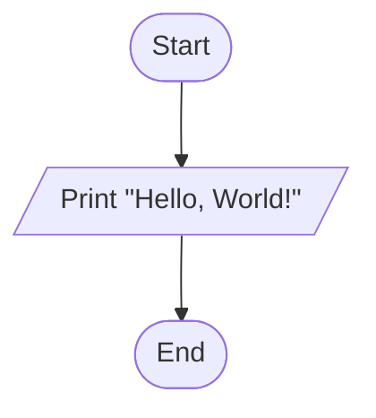
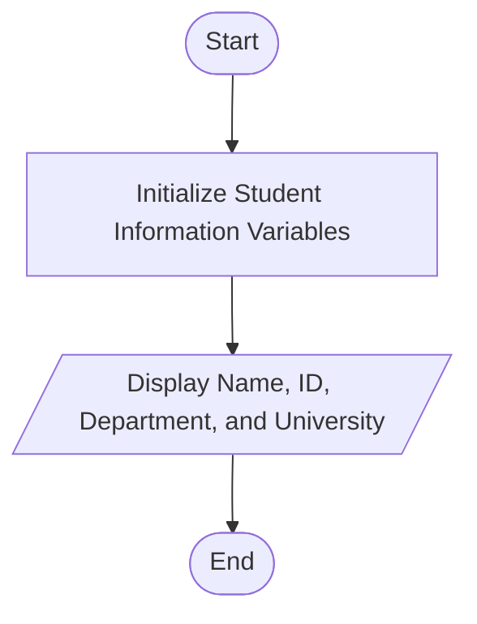

# Lab 01 – Basic C Programming

This folder contains the complete solutions for this lab, including C source programs, flowcharts, input specifications, and verified outputs.

---

### <a id='question-1'></a>Question 1: Write a C program to print "Hello, World!".

#### Flowchart


#### C Program (Code)
```c
#include <stdio.h>

int main(void) {
    // Print Hello, World! to the console
    printf("Hello, World!\n");
    return 0;
}
```

#### Program Input
```text
No input required.
```

#### Program Output
```text
Hello, World!
```

---

### <a id='question-2'></a>Question 2: Write a C program to display your name, ID, department, and university name.

#### Flowchart


#### C Program (Code)
```c
#include <stdio.h>

int main(void) {
    // Student Information Variables
    char name[] = "Md Yasin Arafat";
    char id[] = "1022"; // Replace with your actual Student ID
    char department[] = "Computer Science and Engineering (CSE)";
    char university[] = "Frist Capital University of Bangladesh"; // Replace with your University name

    printf("===========================================\n");
    printf("          STUDENT INFORMATION             \n");
    printf("===========================================\n");
    printf("Name       : %s\n", name);
    printf("ID         : %s\n", id);
    printf("Department : %s\n", department);
    printf("University : %s\n", university);
    printf("===========================================\n");

    return 0;
}
```

#### Program Input
```text
No input required.
```

#### Program Output
```text
===========================================
          STUDENT INFORMATION             
===========================================
Name       : Md Yasin Arafat
ID         : 1022
Department : Computer Science and Engineering (CSE)
University : Frist Capital University of Bangladesh
===========================================
```

---
