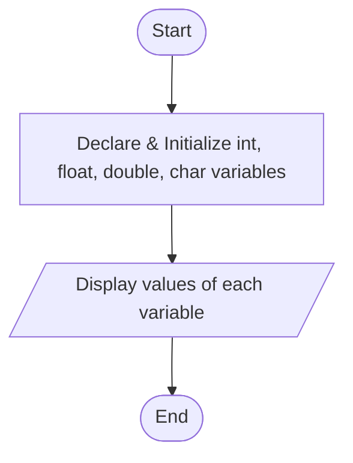
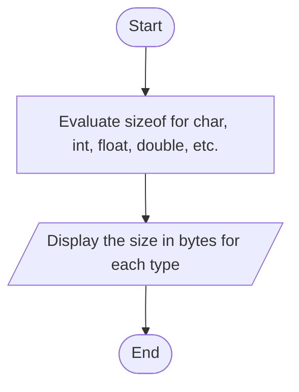

# Lab 02 – Variables, Constants and Data Types

This folder contains the complete solutions for this lab, including C source programs, flowcharts, input specifications, and verified outputs.

---

### <a id='question-4'></a>Question 4: Write a C program to declare and display variables of different data types.

#### Flowchart


#### C Program (Code)
```c
#include <stdio.h>

int main(void) {
    int integerVar = 25;
    float floatVar = 3.14159f;
    double doubleVar = 12345.6789;
    char charVar = 'A';

    printf("Integer value : %d\n", integerVar);
    printf("Float value   : %.2f\n", floatVar);
    printf("Double value  : %.4lf\n", doubleVar);
    printf("Char value    : %c\n", charVar);

    return 0;
}
```

#### Program Input
```text
No input required.
```

#### Program Output
```text
Integer value : 25
Float value   : 3.14
Double value  : 12345.6789
Char value    : A
```

---

### <a id='question-5'></a>Question 5: Write a C program to display the size of different data types using sizeof().

#### Flowchart


#### C Program (Code)
```c
#include <stdio.h>

int main(void) {
    printf("Size of char        : %zu byte(s)\n", sizeof(char));
    printf("Size of short       : %zu byte(s)\n", sizeof(short));
    printf("Size of int         : %zu byte(s)\n", sizeof(int));
    printf("Size of long        : %zu byte(s)\n", sizeof(long));
    printf("Size of long long   : %zu byte(s)\n", sizeof(long long));
    printf("Size of float       : %zu byte(s)\n", sizeof(float));
    printf("Size of double      : %zu byte(s)\n", sizeof(double));
    printf("Size of long double : %zu byte(s)\n", sizeof(long double));

    return 0;
}
```

#### Program Input
```text
No input required.
```

#### Program Output
```text
Size of char        : 1 byte(s)
Size of short       : 2 byte(s)
Size of int         : 4 byte(s)
Size of long        : 8 byte(s)
Size of long long   : 8 byte(s)
Size of float       : 4 byte(s)
Size of double      : 8 byte(s)
Size of long double : 16 byte(s)
```

---
