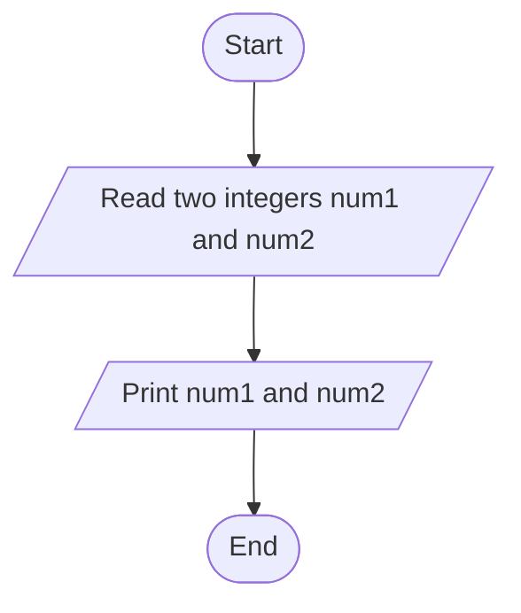
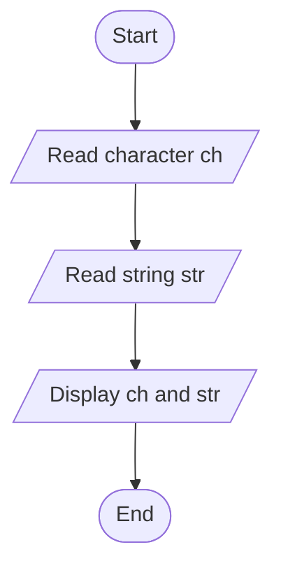

# Lab 03 – Input and Output

This folder contains the complete solutions for this lab, including C source programs, flowcharts, input specifications, and verified outputs.

---

### <a id='question-7'></a>Question 7: Write a C program to take two integers as input and display them.

#### Flowchart


#### C Program (Code)
```c
#include <stdio.h>

int main(void) {
    int num1, num2;

    printf("Enter first integer: ");
    if (scanf("%d", &num1) != 1) return 1;

    printf("Enter second integer: ");
    if (scanf("%d", &num2) != 1) return 1;

    printf("\nYou entered:\n");
    printf("First integer  = %d\n", num1);
    printf("Second integer = %d\n", num2);

    return 0;
}
```

#### Program Input
```text
10
25
```

#### Program Output
```text
Enter first integer: Enter second integer: 
You entered:
First integer  = 10
Second integer = 25
```

---

### <a id='question-8'></a>Question 8: Write a C program to take a character and a string as input and display them.

#### Flowchart


#### C Program (Code)
```c
#include <stdio.h>

int main(void) {
    char ch;
    char str[100];

    printf("Enter a character: ");
    if (scanf(" %c", &ch) != 1) return 1;

    printf("Enter a word/string: ");
    if (scanf("%99s", str) != 1) return 1;

    printf("\nYou entered:\n");
    printf("Character : %c\n", ch);
    printf("String    : %s\n", str);

    return 0;
}
```

#### Program Input
```text
K
Programming
```

#### Program Output
```text
Enter a character: Enter a word/string: 
You entered:
Character : K
String    : Programming
```

---
