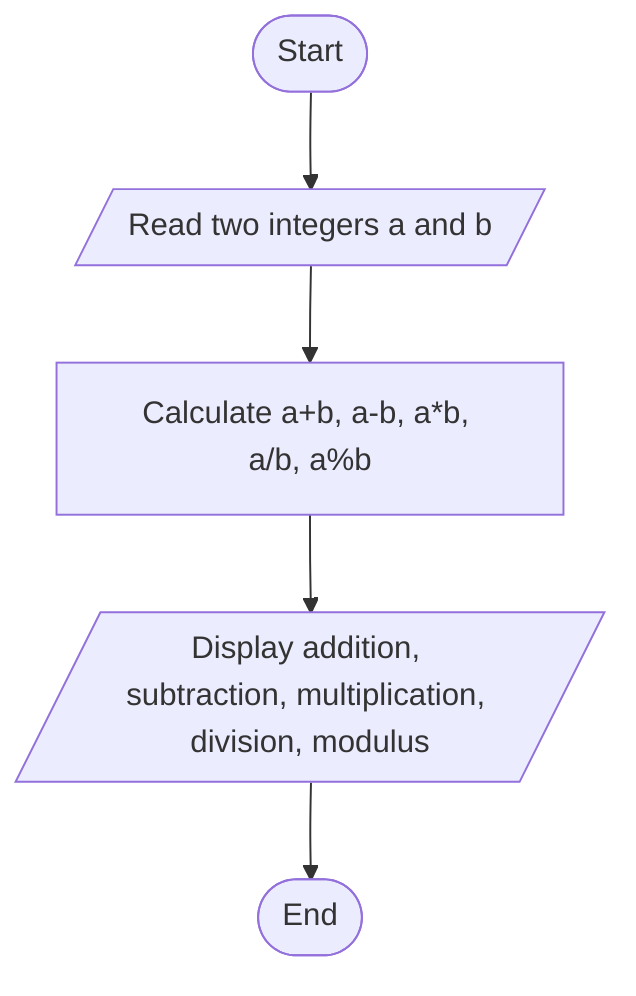
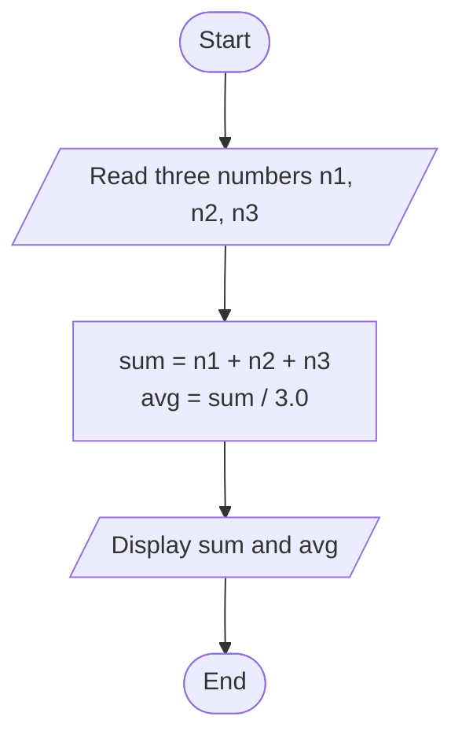

# Lab 04 – Arithmetic Operators

This folder contains the complete solutions for this lab, including C source programs, flowcharts, input specifications, and verified outputs.

---

### <a id='question-10'></a>Question 10: Write a C program to perform addition, subtraction, multiplication, division, and modulus of two numbers.

#### Flowchart


#### C Program (Code)
```c
#include <stdio.h>

int main(void) {
    int a, b;

    printf("Enter two numbers (a and b): ");
    if (scanf("%d %d", &a, &b) != 2) return 1;

    printf("\n--- Arithmetic Operations ---\n");
    printf("Addition       (%d + %d) = %d\n", a, b, a + b);
    printf("Subtraction    (%d - %d) = %d\n", a, b, a - b);
    printf("Multiplication (%d * %d) = %d\n", a, b, a * b);

    if (b != 0) {
        printf("Division       (%d / %d) = %.2f\n", a, b, (float)a / b);
        printf("Modulus        (%d %% %d) = %d\n", a, b, a % b);
    } else {
        printf("Division and Modulus by zero are not allowed.\n");
    }

    return 0;
}
```

#### Program Input
```text
20 6
```

#### Program Output
```text
Enter two numbers (a and b): 
--- Arithmetic Operations ---
Addition       (20 + 6) = 26
Subtraction    (20 - 6) = 14
Multiplication (20 * 6) = 120
Division       (20 / 6) = 3.33
Modulus        (20 % 6) = 2
```

---

### <a id='question-11'></a>Question 11: Write a C program to calculate the sum and average of three numbers.

#### Flowchart


#### C Program (Code)
```c
#include <stdio.h>

int main(void) {
    double num1, num2, num3;
    double sum, average;

    printf("Enter three numbers: ");
    if (scanf("%lf %lf %lf", &num1, &num2, &num3) != 3) return 1;

    sum = num1 + num2 + num3;
    average = sum / 3.0;

    printf("\nSum     = %.2lf\n", sum);
    printf("Average = %.2lf\n", average);

    return 0;
}
```

#### Program Input
```text
15 25 35
```

#### Program Output
```text
Enter three numbers: 
Sum     = 75.00
Average = 25.00
```

---
