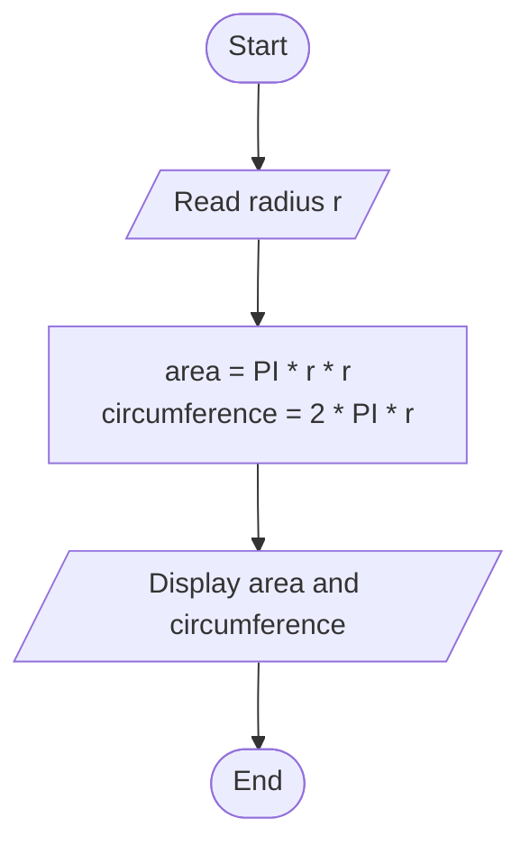
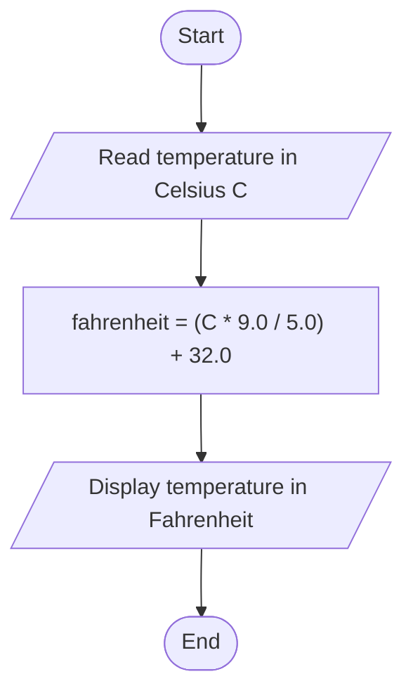

# Lab 05 – More Arithmetic Problems

This folder contains the complete solutions for this lab, including C source programs, flowcharts, input specifications, and verified outputs.

---

### <a id='question-13'></a>Question 13: Write a C program to calculate the area and circumference of a circle.

#### Flowchart


#### C Program (Code)
```c
#include <stdio.h>
#define PI 3.141592653589793

int main(void) {
    double radius, area, circumference;

    printf("Enter radius of the circle: ");
    if (scanf("%lf", &radius) != 1) return 1;

    area = PI * radius * radius;
    circumference = 2.0 * PI * radius;

    printf("\nRadius        = %.2lf\n", radius);
    printf("Area          = %.2lf\n", area);
    printf("Circumference = %.2lf\n", circumference);

    return 0;
}
```

#### Program Input
```text
5
```

#### Program Output
```text
Enter radius of the circle: 
Radius        = 5.00
Area          = 78.54
Circumference = 31.42
```

---

### <a id='question-14'></a>Question 14: Write a C program to convert Celsius to Fahrenheit.

#### Flowchart


#### C Program (Code)
```c
#include <stdio.h>

int main(void) {
    double celsius, fahrenheit;

    printf("Enter temperature in Celsius: ");
    if (scanf("%lf", &celsius) != 1) return 1;

    fahrenheit = (celsius * 9.0 / 5.0) + 32.0;

    printf("\n%.2lf Celsius = %.2lf Fahrenheit\n", celsius, fahrenheit);

    return 0;
}
```

#### Program Input
```text
37
```

#### Program Output
```text
Enter temperature in Celsius: 
37.00 Celsius = 98.60 Fahrenheit
```

---
