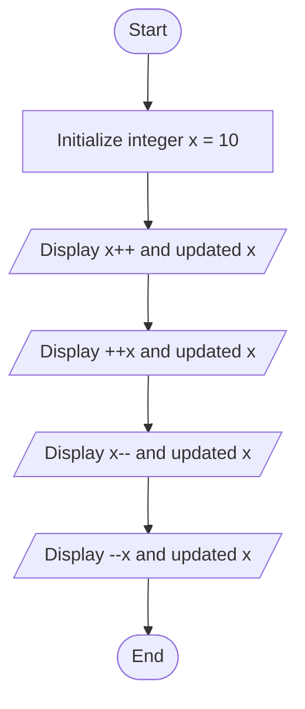
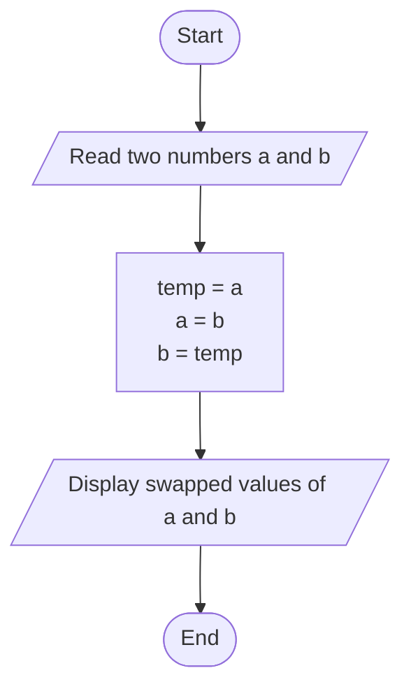

# Lab 06 – Increment, Decrement and Assignment Operators

This folder contains the complete solutions for this lab, including C source programs, flowcharts, input specifications, and verified outputs.

---

### <a id='question-17'></a>Question 17: Write a C program to demonstrate the use of increment and decrement operators.

#### Flowchart


#### C Program (Code)
```c
#include <stdio.h>

int main(void) {
    int x = 10;

    printf("Initial value of x: %d\n\n", x);

    printf("Post-increment (x++): %d\n", x++);
    printf("Value of x after x++: %d\n\n", x);

    printf("Pre-increment (++x): %d\n", ++x);
    printf("Value of x after ++x: %d\n\n", x);

    printf("Post-decrement (x--): %d\n", x--);
    printf("Value of x after x--: %d\n\n", x);

    printf("Pre-decrement (--x): %d\n", --x);
    printf("Value of x after --x: %d\n", x);

    return 0;
}
```

#### Program Input
```text
No input required.
```

#### Program Output
```text
Initial value of x: 10

Post-increment (x++): 10
Value of x after x++: 11

Pre-increment (++x): 12
Value of x after ++x: 12

Post-decrement (x--): 12
Value of x after x--: 11

Pre-decrement (--x): 10
Value of x after --x: 10
```

---

### <a id='question-18'></a>Question 18: Write a C program to swap two numbers using a third variable.

#### Flowchart


#### C Program (Code)
```c
#include <stdio.h>

int main(void) {
    int a, b, temp;

    printf("Enter first number (a): ");
    if (scanf("%d", &a) != 1) return 1;

    printf("Enter second number (b): ");
    if (scanf("%d", &b) != 1) return 1;

    printf("\nBefore Swapping: a = %d, b = %d\n", a, b);

    // Swapping logic using temporary variable
    temp = a;
    a = b;
    b = temp;

    printf("After Swapping : a = %d, b = %d\n", a, b);

    return 0;
}
```

#### Program Input
```text
10
20
```

#### Program Output
```text
Enter first number (a): Enter second number (b): 
Before Swapping: a = 10, b = 20
After Swapping : a = 20, b = 10
```

---
