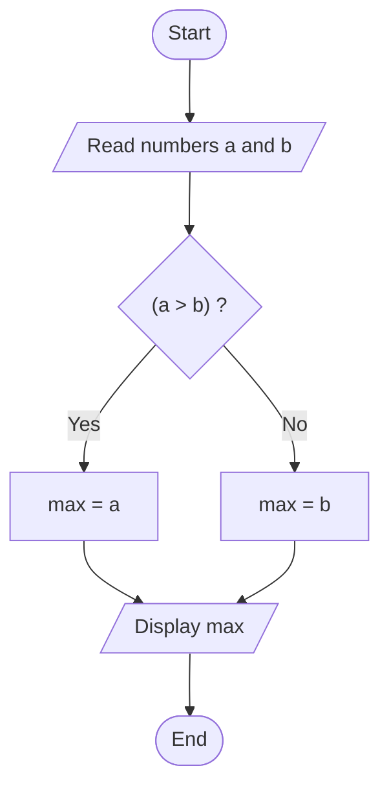
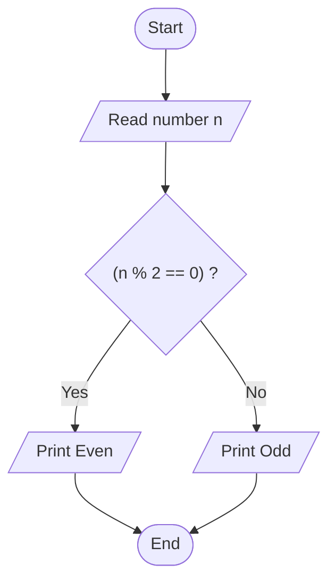

# Lab 07 – Conditional Operator

This folder contains the complete solutions for this lab, including C source programs, flowcharts, input specifications, and verified outputs.

---

### <a id='question-20'></a>Question 20: Write a C program to find the larger of two numbers using the conditional operator.

#### Flowchart


#### C Program (Code)
```c
#include <stdio.h>

int main(void) {
    int num1, num2, max;

    printf("Enter two numbers: ");
    if (scanf("%d %d", &num1, &num2) != 2) return 1;

    // Using ternary (conditional) operator
    max = (num1 > num2) ? num1 : num2;

    printf("The larger number is: %d\n", max);

    return 0;
}
```

#### Program Input
```text
45 78
```

#### Program Output
```text
Enter two numbers: The larger number is: 78
```

---

### <a id='question-21'></a>Question 21: Write a C program to check whether a number is even or odd using the conditional operator.

#### Flowchart


#### C Program (Code)
```c
#include <stdio.h>

int main(void) {
    int num;

    printf("Enter an integer: ");
    if (scanf("%d", &num) != 1) return 1;

    // Using conditional operator to check even or odd
    (num % 2 == 0) ? printf("%d is Even\n", num) : printf("%d is Odd\n", num);

    return 0;
}
```

#### Program Input
```text
17
```

#### Program Output
```text
Enter an integer: 17 is Odd
```

---
