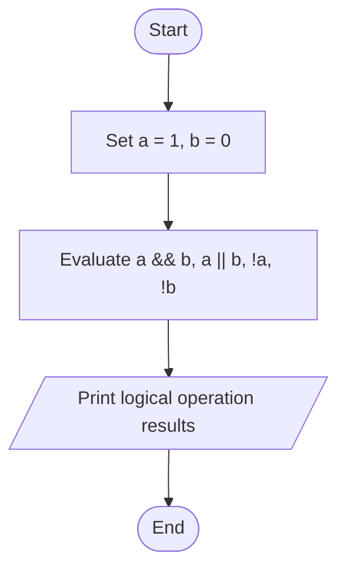
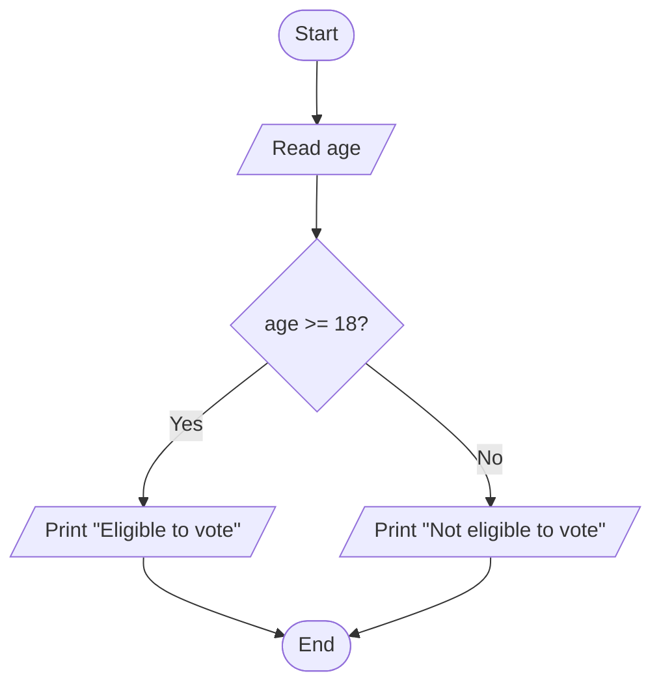

# Lab 08 – Relational and Logical Operators

This folder contains the complete solutions for this lab, including C source programs, flowcharts, input specifications, and verified outputs.

---

### <a id='question-23'></a>Question 23: Write a C program to demonstrate the use of logical AND, OR, and NOT operators.

#### Flowchart


#### C Program (Code)
```c
#include <stdio.h>

int main(void) {
    int a = 1; // Represents True
    int b = 0; // Represents False

    printf("Given: a = %d (True), b = %d (False)\n\n", a, b);

    // Logical AND (&&)
    printf("Logical AND (a && b) : %d\n", a && b);

    // Logical OR (||)
    printf("Logical OR  (a || b) : %d\n", a || b);

    // Logical NOT (!)
    printf("Logical NOT (!a)     : %d\n", !a);
    printf("Logical NOT (!b)     : %d\n", !b);

    return 0;
}
```

#### Program Input
```text
No input required.
```

#### Program Output
```text
Given: a = 1 (True), b = 0 (False)

Logical AND (a && b) : 0
Logical OR  (a || b) : 1
Logical NOT (!a)     : 0
Logical NOT (!b)     : 1
```

---

### <a id='question-24'></a>Question 24: Write a C program to check whether a person is eligible to vote.

#### Flowchart


#### C Program (Code)
```c
#include <stdio.h>

int main(void) {
    int age;

    printf("Enter your age: ");
    if (scanf("%d", &age) != 1) return 1;

    if (age >= 18) {
        printf("You are eligible to vote.\n");
    } else {
        printf("You are not eligible to vote. You must wait %d more year(s).\n", 18 - age);
    }

    return 0;
}
```

#### Program Input
```text
20
```

#### Program Output
```text
Enter your age: You are eligible to vote.
```

---
