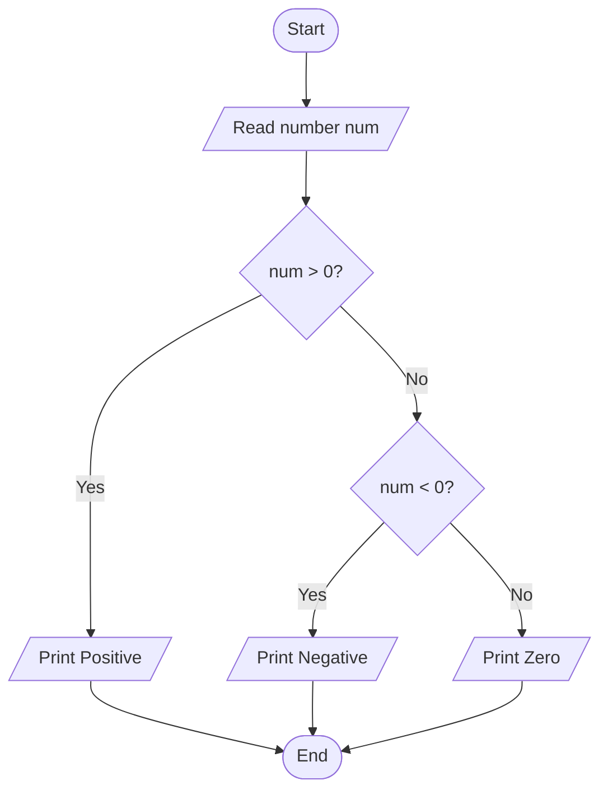
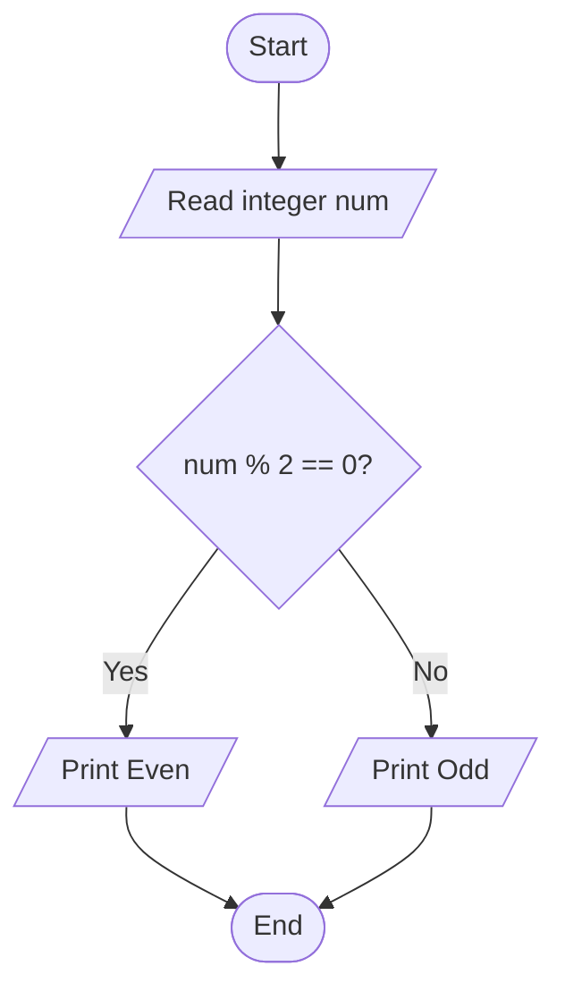

# Lab 09 – if Statement

This folder contains the complete solutions for this lab, including C source programs, flowcharts, input specifications, and verified outputs.

---

### <a id='question-26'></a>Question 26: Write a C program to check whether a number is positive, negative, or zero.

#### Flowchart


#### C Program (Code)
```c
#include <stdio.h>

int main(void) {
    int num;

    printf("Enter a number: ");
    if (scanf("%d", &num) != 1) return 1;

    if (num > 0) {
        printf("%d is Positive.\n", num);
    }
    if (num < 0) {
        printf("%d is Negative.\n", num);
    }
    if (num == 0) {
        printf("The number is Zero.\n");
    }

    return 0;
}
```

#### Program Input
```text
-12
```

#### Program Output
```text
Enter a number: -12 is Negative.
```

---

### <a id='question-27'></a>Question 27: Write a C program to check whether a number is even or odd.

#### Flowchart


#### C Program (Code)
```c
#include <stdio.h>

int main(void) {
    int num;

    printf("Enter an integer: ");
    if (scanf("%d", &num) != 1) return 1;

    if (num % 2 == 0) {
        printf("%d is Even.\n", num);
    }
    if (num % 2 != 0) {
        printf("%d is Odd.\n", num);
    }

    return 0;
}
```

#### Program Input
```text
28
```

#### Program Output
```text
Enter an integer: 28 is Even.
```

---
