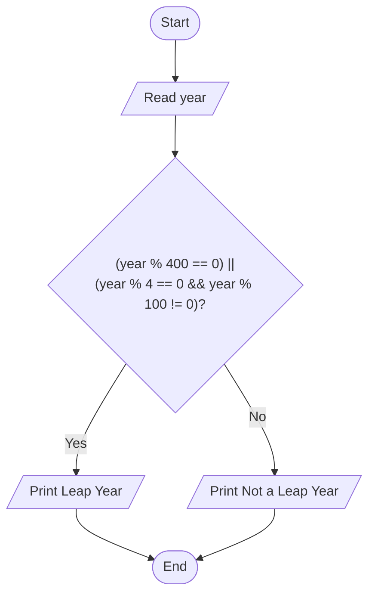
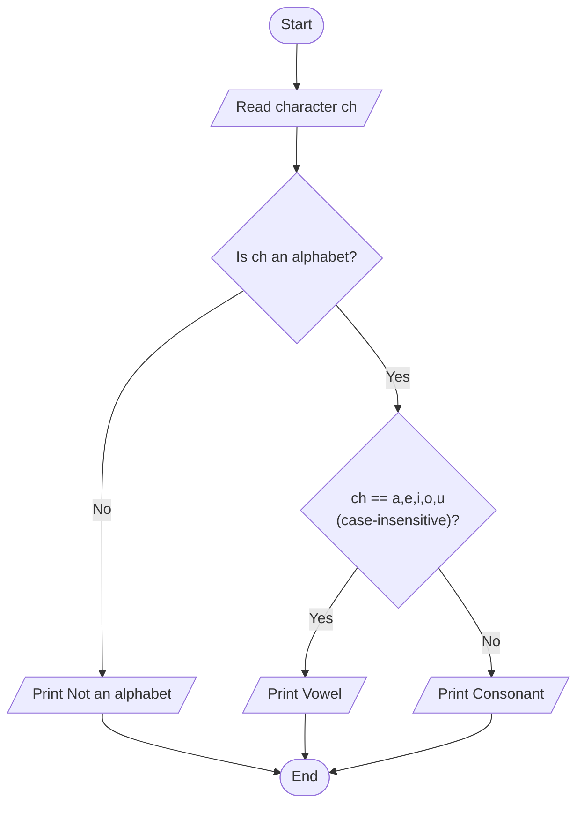

# Lab 10 – if-else Statement

This folder contains the complete solutions for this lab, including C source programs, flowcharts, input specifications, and verified outputs.

---

### <a id='question-29'></a>Question 29: Write a C program to check whether a year is a leap year or not.

#### Flowchart


#### C Program (Code)
```c
#include <stdio.h>

int main(void) {
    int year;

    printf("Enter a year: ");
    if (scanf("%d", &year) != 1) return 1;

    // Leap year condition:
    // Divisible by 400 OR (divisible by 4 and NOT divisible by 100)
    if ((year % 400 == 0) || (year % 4 == 0 && year % 100 != 0)) {
        printf("%d is a Leap Year.\n", year);
    } else {
        printf("%d is Not a Leap Year.\n", year);
    }

    return 0;
}
```

#### Program Input
```text
2024
```

#### Program Output
```text
Enter a year: 2024 is a Leap Year.
```

---

### <a id='question-30'></a>Question 30: Write a C program to check whether a character is a vowel or consonant.

#### Flowchart


#### C Program (Code)
```c
#include <stdio.h>
#include <ctype.h>

int main(void) {
    char ch;

    printf("Enter an alphabet character: ");
    if (scanf(" %c", &ch) != 1) return 1;

    if (!isalpha(ch)) {
        printf("'%c' is not an alphabet letter.\n", ch);
    } else {
        char lower = tolower(ch);
        if (lower == 'a' || lower == 'e' || lower == 'i' || lower == 'o' || lower == 'u') {
            printf("'%c' is a Vowel.\n", ch);
        } else {
            printf("'%c' is a Consonant.\n", ch);
        }
    }

    return 0;
}
```

#### Program Input
```text
e
```

#### Program Output
```text
Enter an alphabet character: 'e' is a Vowel.
```

---
