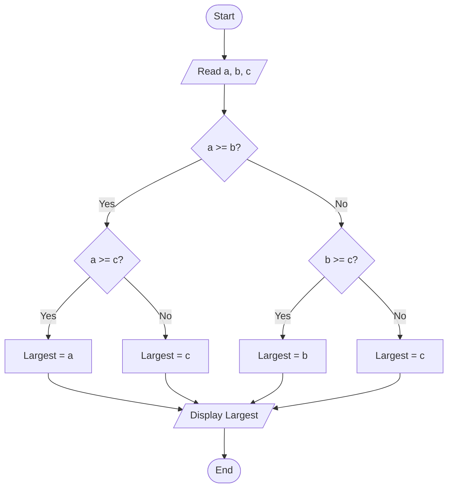
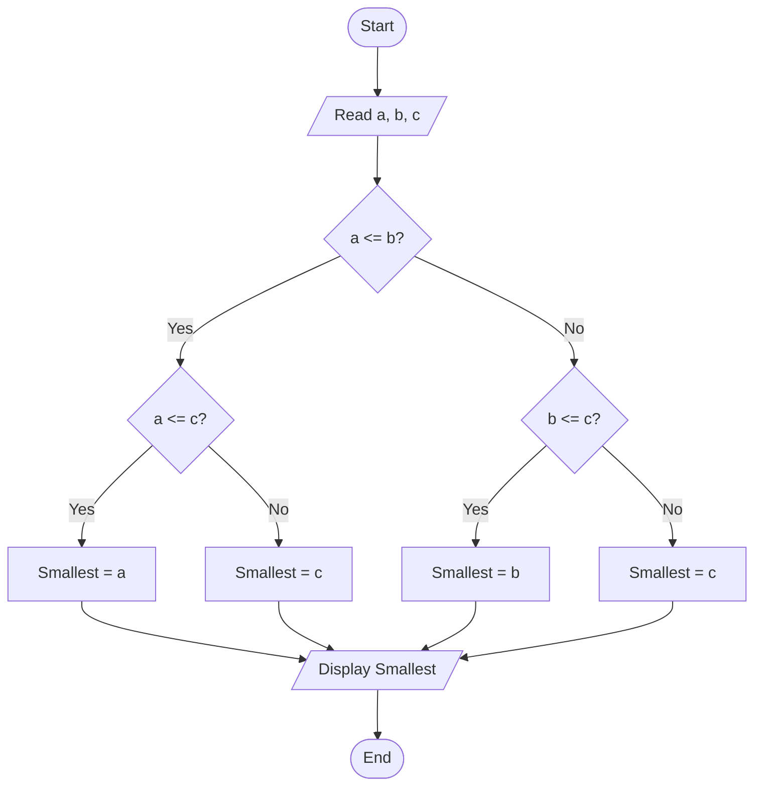

# Lab 11 – Nested if

This folder contains the complete solutions for this lab, including C source programs, flowcharts, input specifications, and verified outputs.

---

### <a id='question-32'></a>Question 32: Write a C program to find the largest among three numbers using nested if.

#### Flowchart


#### C Program (Code)
```c
#include <stdio.h>

int main(void) {
    int a, b, c, largest;

    printf("Enter three numbers: ");
    if (scanf("%d %d %d", &a, &b, &c) != 3) return 1;

    // Finding largest using nested if
    if (a >= b) {
        if (a >= c) {
            largest = a;
        } else {
            largest = c;
        }
    } else {
        if (b >= c) {
            largest = b;
        } else {
            largest = c;
        }
    }

    printf("The largest number is: %d\n", largest);

    return 0;
}
```

#### Program Input
```text
25 60 42
```

#### Program Output
```text
Enter three numbers: The largest number is: 60
```

---

### <a id='question-33'></a>Question 33: Write a C program to find the smallest among three numbers using nested if.

#### Flowchart


#### C Program (Code)
```c
#include <stdio.h>

int main(void) {
    int a, b, c, smallest;

    printf("Enter three numbers: ");
    if (scanf("%d %d %d", &a, &b, &c) != 3) return 1;

    // Finding smallest using nested if
    if (a <= b) {
        if (a <= c) {
            smallest = a;
        } else {
            smallest = c;
        }
    } else {
        if (b <= c) {
            smallest = b;
        } else {
            smallest = c;
        }
    }

    printf("The smallest number is: %d\n", smallest);

    return 0;
}
```

#### Program Input
```text
25 60 42
```

#### Program Output
```text
Enter three numbers: The smallest number is: 25
```

---
