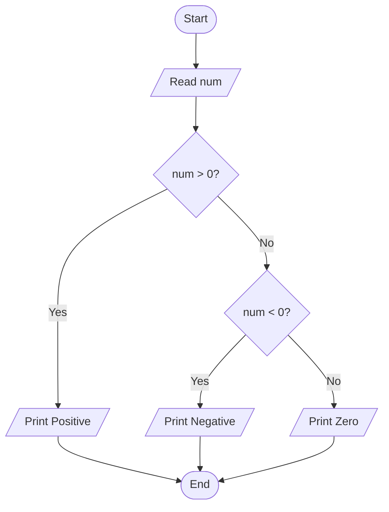
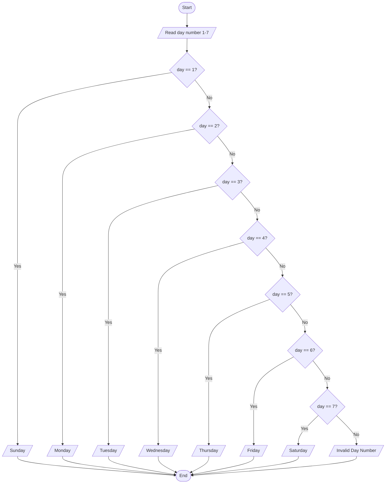

# Lab 12 – else-if Ladder

This folder contains the complete solutions for this lab, including C source programs, flowcharts, input specifications, and verified outputs.

---

### <a id='question-35'></a>Question 35: Write a C program to determine whether a number is positive, negative, or zero using an else-if ladder.

#### Flowchart


#### C Program (Code)
```c
#include <stdio.h>

int main(void) {
    int num;

    printf("Enter a number: ");
    if (scanf("%d", &num) != 1) return 1;

    // Using else-if ladder
    if (num > 0) {
        printf("%d is Positive.\n", num);
    } else if (num < 0) {
        printf("%d is Negative.\n", num);
    } else {
        printf("The number is Zero.\n");
    }

    return 0;
}
```

#### Program Input
```text
0
```

#### Program Output
```text
Enter a number: The number is Zero.
```

---

### <a id='question-36'></a>Question 36: Write a C program to display the day of the week based on a number from 1 to 7.

#### Flowchart


#### C Program (Code)
```c
#include <stdio.h>

int main(void) {
    int day;

    printf("Enter day number (1-7): ");
    if (scanf("%d", &day) != 1) return 1;

    // else-if ladder for day names
    if (day == 1) {
        printf("Day %d is Sunday\n", day);
    } else if (day == 2) {
        printf("Day %d is Monday\n", day);
    } else if (day == 3) {
        printf("Day %d is Tuesday\n", day);
    } else if (day == 4) {
        printf("Day %d is Wednesday\n", day);
    } else if (day == 5) {
        printf("Day %d is Thursday\n", day);
    } else if (day == 6) {
        printf("Day %d is Friday\n", day);
    } else if (day == 7) {
        printf("Day %d is Saturday\n", day);
    } else {
        printf("Invalid input! Please enter a number between 1 and 7.\n");
    }

    return 0;
}
```

#### Program Input
```text
5
```

#### Program Output
```text
Enter day number (1-7): Day 5 is Thursday
```

---
