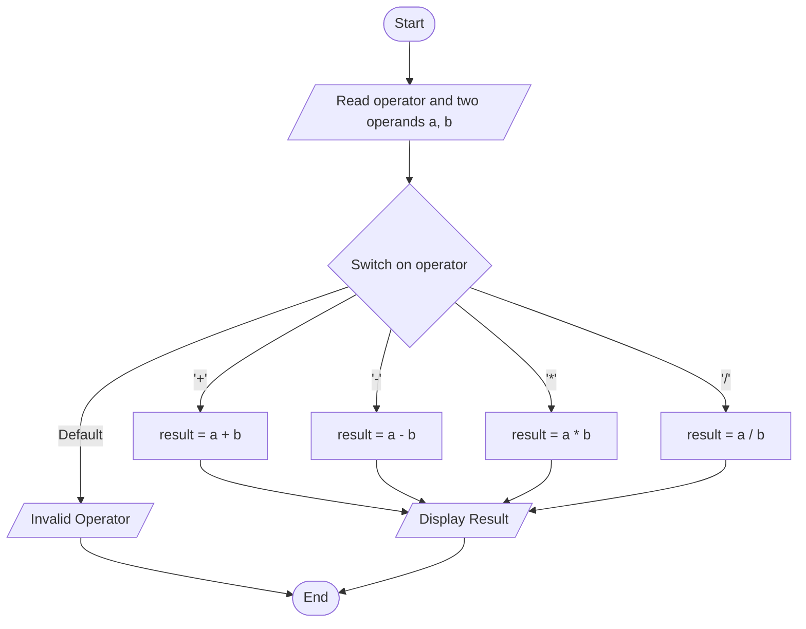
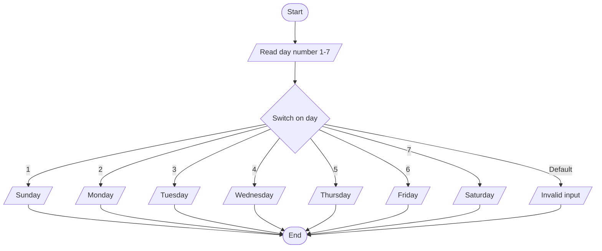

# Lab 13 – switch Statement

This folder contains the complete solutions for this lab, including C source programs, flowcharts, input specifications, and verified outputs.

---

### <a id='question-38'></a>Question 38: Write a C program to perform basic arithmetic operations using switch.

#### Flowchart


#### C Program (Code)
```c
#include <stdio.h>

int main(void) {
    char op;
    double a, b;

    printf("Enter an operator (+, -, *, /): ");
    if (scanf(" %c", &op) != 1) return 1;

    printf("Enter two operands: ");
    if (scanf("%lf %lf", &a, &b) != 2) return 1;

    switch (op) {
        case '+':
            printf("%.2lf + %.2lf = %.2lf\n", a, b, a + b);
            break;
        case '-':
            printf("%.2lf - %.2lf = %.2lf\n", a, b, a - b);
            break;
        case '*':
            printf("%.2lf * %.2lf = %.2lf\n", a, b, a * b);
            break;
        case '/':
            if (b != 0) {
                printf("%.2lf / %.2lf = %.2lf\n", a, b, a / b);
            } else {
                printf("Error: Division by zero is not allowed.\n");
            }
            break;
        default:
            printf("Error: '%c' is not a valid operator.\n", op);
    }

    return 0;
}
```

#### Program Input
```text
+
12 8
```

#### Program Output
```text
Enter an operator (+, -, *, /): Enter two operands: 12.00 + 8.00 = 20.00
```

---

### <a id='question-39'></a>Question 39: Write a C program to display the day of the week using switch.

#### Flowchart


#### C Program (Code)
```c
#include <stdio.h>

int main(void) {
    int day;

    printf("Enter day number (1-7): ");
    if (scanf("%d", &day) != 1) return 1;

    switch (day) {
        case 1:
            printf("Sunday\n");
            break;
        case 2:
            printf("Monday\n");
            break;
        case 3:
            printf("Tuesday\n");
            break;
        case 4:
            printf("Wednesday\n");
            break;
        case 5:
            printf("Thursday\n");
            break;
        case 6:
            printf("Friday\n");
            break;
        case 7:
            printf("Saturday\n");
            break;
        default:
            printf("Invalid input! Please enter a number between 1 and 7.\n");
    }

    return 0;
}
```

#### Program Input
```text
3
```

#### Program Output
```text
Enter day number (1-7): Tuesday
```

---
