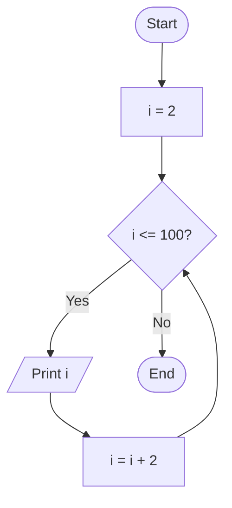

# Lab 14 – Loops

This folder contains the complete solutions for this lab, including C source programs, flowcharts, input specifications, and verified outputs.

---

### <a id='question-41'></a>Question 41: Write a C program to print numbers from 1 to 100 using a for loop.

#### Flowchart


#### C Program (Code)
```c
#include <stdio.h>

int main(void) {
    printf("Numbers from 1 to 100:\n");
    for (int i = 1; i <= 100; i++) {
        printf("%d ", i);
        if (i % 10 == 0) {
            printf("\n");
        }
    }
    return 0;
}
```

#### Program Input
```text
No input required.
```

#### Program Output
```text
Numbers from 1 to 100:
1 2 3 4 5 6 7 8 9 10 
11 12 13 14 15 16 17 18 19 20 
...
91 92 93 94 95 96 97 98 99 100
```

---

### <a id='question-42'></a>Question 42: Write a C program to print even numbers from 1 to 100.

#### Flowchart


#### C Program (Code)
```c
#include <stdio.h>

int main(void) {
    printf("Even numbers from 1 to 100:\n");
    for (int i = 2; i <= 100; i += 2) {
        printf("%d ", i);
        if (i % 20 == 0) {
            printf("\n");
        }
    }
    return 0;
}
```

#### Program Input
```text
No input required.
```

#### Program Output
```text
Even numbers from 1 to 100:
2 4 6 8 10 12 14 16 18 20 
22 24 26 28 30 32 34 36 38 40 
42 44 46 48 50 52 54 56 58 60 
62 64 66 68 70 72 74 76 78 80 
82 84 86 88 90 92 94 96 98 100
```

---
