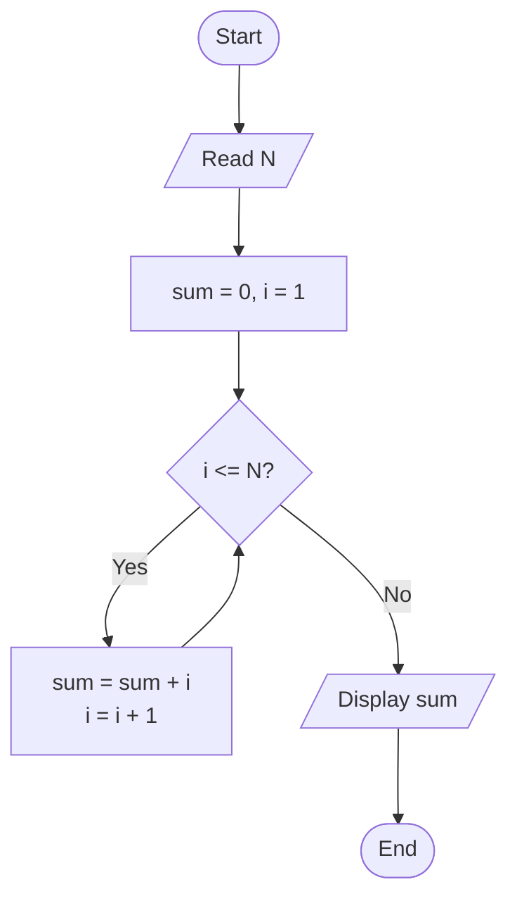
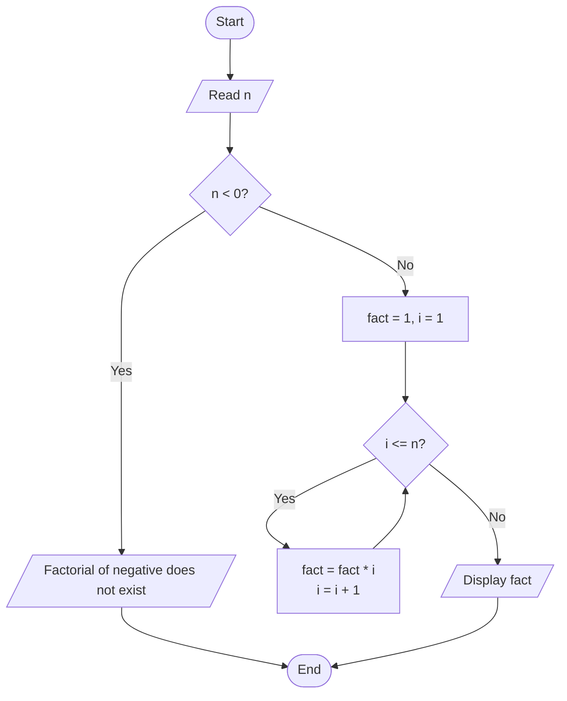

# Lab 15 – for Loop Problems

This folder contains the complete solutions for this lab, including C source programs, flowcharts, input specifications, and verified outputs.

---

### <a id='question-44'></a>Question 44: Write a C program to calculate the sum of the first N natural numbers.

#### Flowchart


#### C Program (Code)
```c
#include <stdio.h>

int main(void) {
    int n, sum = 0;

    printf("Enter a positive integer N: ");
    if (scanf("%d", &n) != 1) return 1;

    for (int i = 1; i <= n; i++) {
        sum += i;
    }

    printf("Sum of first %d natural numbers = %d\n", n, sum);

    return 0;
}
```

#### Program Input
```text
10
```

#### Program Output
```text
Enter a positive integer N: Sum of first 10 natural numbers = 55
```

---

### <a id='question-45'></a>Question 45: Write a C program to calculate the factorial of a number.

#### Flowchart


#### C Program (Code)
```c
#include <stdio.h>

int main(void) {
    int n;
    unsigned long long factorial = 1;

    printf("Enter a non-negative integer: ");
    if (scanf("%d", &n) != 1) return 1;

    if (n < 0) {
        printf("Error: Factorial of a negative number does not exist.\n");
    } else {
        for (int i = 1; i <= n; i++) {
            factorial *= (unsigned long long)i;
        }
        printf("Factorial of %d = %llu\n", n, factorial);
    }

    return 0;
}
```

#### Program Input
```text
5
```

#### Program Output
```text
Enter a non-negative integer: Factorial of 5 = 120
```

---
