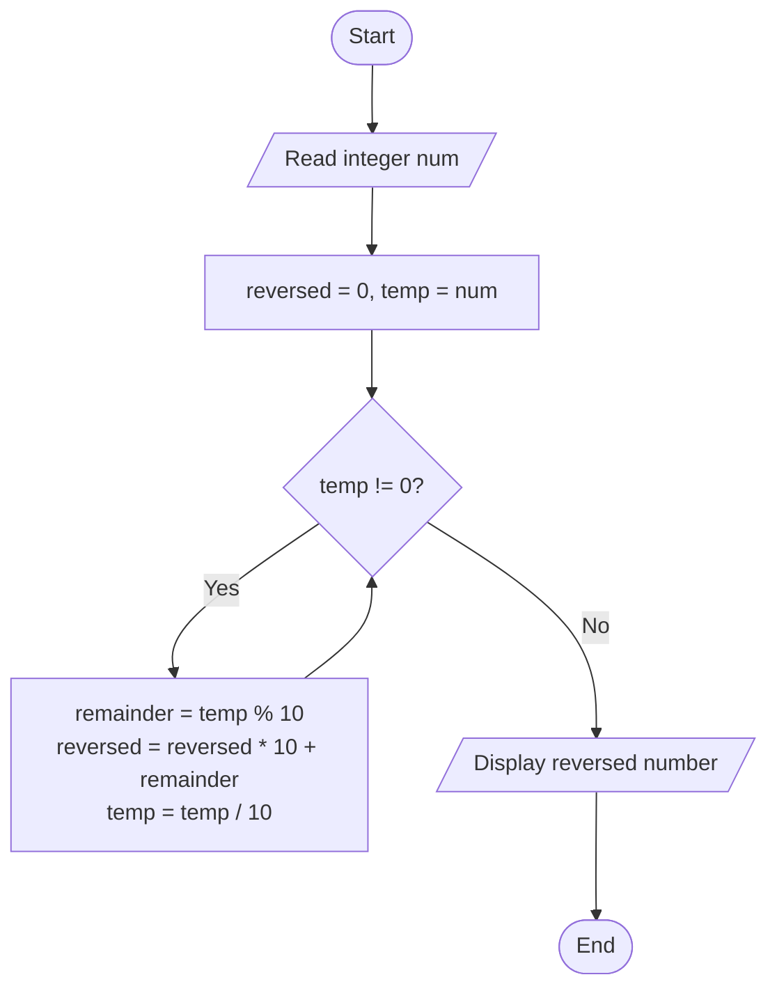
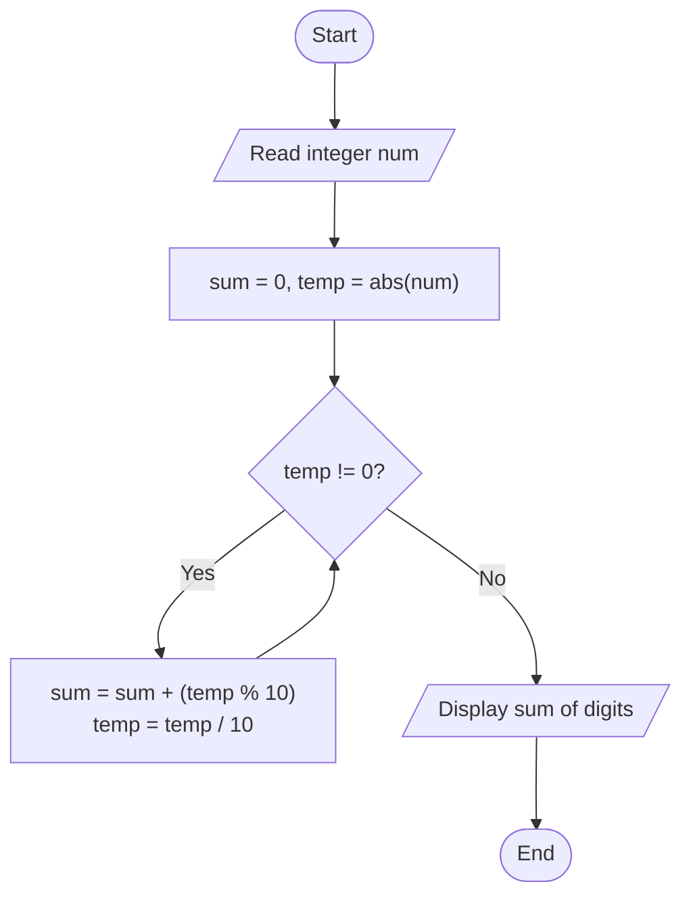

# Lab 16 – while and do-while

This folder contains the complete solutions for this lab, including C source programs, flowcharts, input specifications, and verified outputs.

---

### <a id='question-47'></a>Question 47: Write a C program to reverse the digits of an integer using a while loop.

#### Flowchart


#### C Program (Code)
```c
#include <stdio.h>

int main(void) {
    int num, reversed = 0, temp;

    printf("Enter an integer: ");
    if (scanf("%d", &num) != 1) return 1;

    temp = num;
    while (temp != 0) {
        int remainder = temp % 10;
        reversed = reversed * 10 + remainder;
        temp /= 10;
    }

    printf("Original number : %d\n", num);
    printf("Reversed number : %d\n", reversed);

    return 0;
}
```

#### Program Input
```text
12345
```

#### Program Output
```text
Enter an integer: Original number : 12345
Reversed number : 54321
```

---

### <a id='question-48'></a>Question 48: Write a C program to find the sum of the digits of a number.

#### Flowchart


#### C Program (Code)
```c
#include <stdio.h>
#include <stdlib.h>

int main(void) {
    int num, temp, sum = 0;

    printf("Enter an integer: ");
    if (scanf("%d", &num) != 1) return 1;

    temp = abs(num);
    while (temp != 0) {
        sum += temp % 10;
        temp /= 10;
    }

    printf("Sum of digits of %d = %d\n", num, sum);

    return 0;
}
```

#### Program Input
```text
456
```

#### Program Output
```text
Enter an integer: Sum of digits of 456 = 15
```

---
