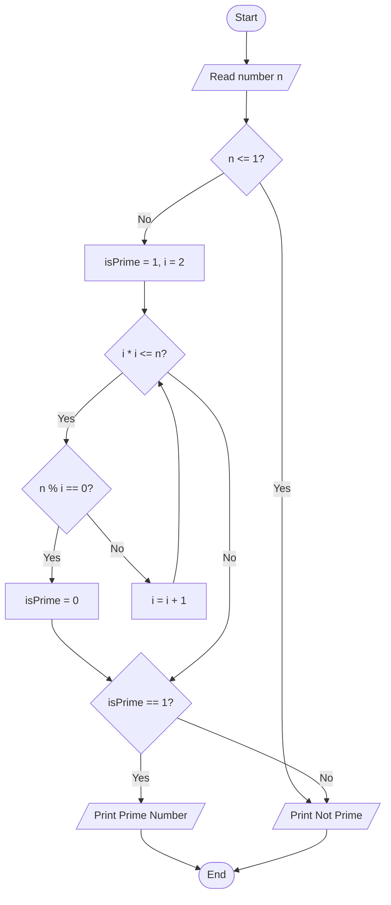
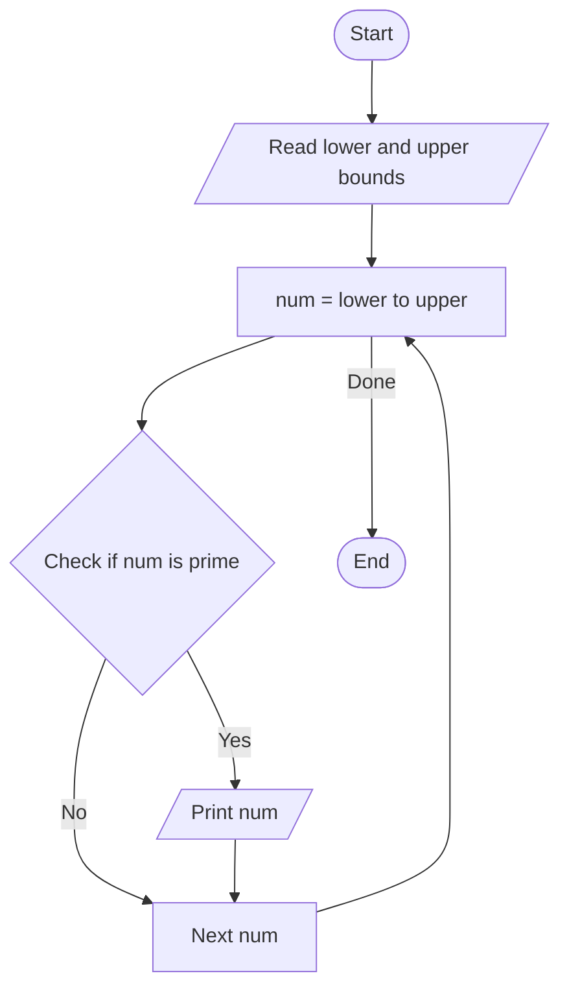

# Lab 17 – Number Problems

This folder contains the complete solutions for this lab, including C source programs, flowcharts, input specifications, and verified outputs.

---

### <a id='question-50'></a>Question 50: Write a C program to check whether a number is a prime number.

#### Flowchart


#### C Program (Code)
```c
#include <stdio.h>

int main(void) {
    int n, isPrime = 1;

    printf("Enter a positive integer: ");
    if (scanf("%d", &n) != 1) return 1;

    if (n <= 1) {
        isPrime = 0;
    } else {
        for (int i = 2; i * i <= n; i++) {
            if (n % i == 0) {
                isPrime = 0;
                break;
            }
        }
    }

    if (isPrime) {
        printf("%d is a Prime Number.\n", n);
    } else {
        printf("%d is Not a Prime Number.\n", n);
    }

    return 0;
}
```

#### Program Input
```text
29
```

#### Program Output
```text
Enter a positive integer: 29 is a Prime Number.
```

---

### <a id='question-51'></a>Question 51: Write a C program to print all prime numbers between two given numbers.

#### Flowchart


#### C Program (Code)
```c
#include <stdio.h>

int main(void) {
    int lower, upper;

    printf("Enter lower bound and upper bound: ");
    if (scanf("%d %d", &lower, &upper) != 2) return 1;

    printf("Prime numbers between %d and %d are:\n", lower, upper);

    for (int i = lower; i <= upper; i++) {
        if (i <= 1) continue;

        int isPrime = 1;
        for (int j = 2; j * j <= i; j++) {
            if (i % j == 0) {
                isPrime = 0;
                break;
            }
        }
        if (isPrime) {
            printf("%d ", i);
        }
    }
    printf("\n");

    return 0;
}
```

#### Program Input
```text
10 30
```

#### Program Output
```text
Enter lower bound and upper bound: Prime numbers between 10 and 30 are:
11 13 17 19 23 29
```

---
