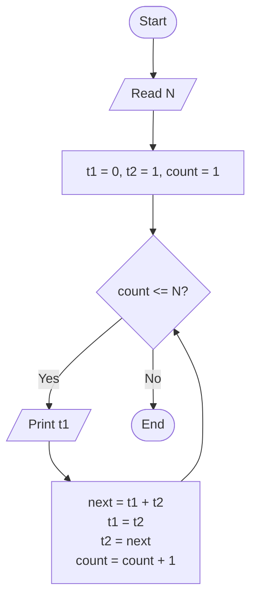
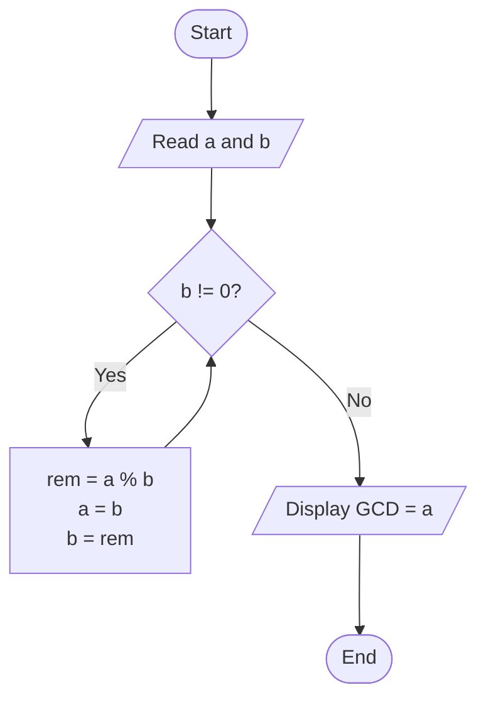

# Lab 18 – Number Series

This folder contains the complete solutions for this lab, including C source programs, flowcharts, input specifications, and verified outputs.

---

### <a id='question-53'></a>Question 53: Write a C program to generate the Fibonacci series up to N terms.

#### Flowchart


#### C Program (Code)
```c
#include <stdio.h>

int main(void) {
    int n;
    long long t1 = 0, t2 = 1, nextTerm;

    printf("Enter the number of terms (N): ");
    if (scanf("%d", &n) != 1) return 1;

    printf("Fibonacci Series (%d terms):\n", n);

    for (int i = 1; i <= n; i++) {
        printf("%lld ", t1);
        nextTerm = t1 + t2;
        t1 = t2;
        t2 = nextTerm;
    }
    printf("\n");

    return 0;
}
```

#### Program Input
```text
8
```

#### Program Output
```text
Enter the number of terms (N): Fibonacci Series (8 terms):
0 1 1 2 3 5 8 13
```

---

### <a id='question-54'></a>Question 54: Write a C program to find the GCD of two numbers.

#### Flowchart


#### C Program (Code)
```c
#include <stdio.h>

int main(void) {
    int n1, n2, a, b, rem;

    printf("Enter two positive integers: ");
    if (scanf("%d %d", &n1, &n2) != 2) return 1;

    a = n1;
    b = n2;

    // Euclidean Algorithm for GCD
    while (b != 0) {
        rem = a % b;
        a = b;
        b = rem;
    }

    printf("The GCD of %d and %d is: %d\n", n1, n2, a);

    return 0;
}
```

#### Program Input
```text
48 18
```

#### Program Output
```text
Enter two positive integers: The GCD of 48 and 18 is: 6
```

---
