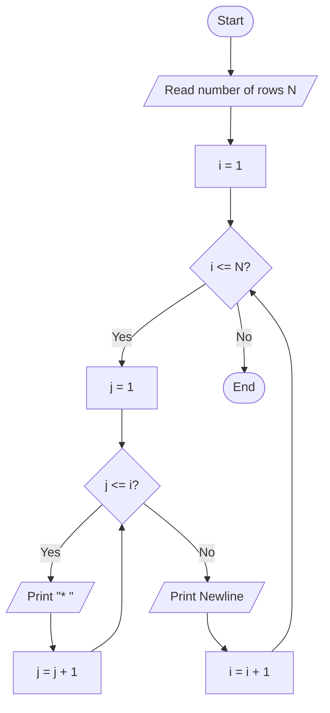
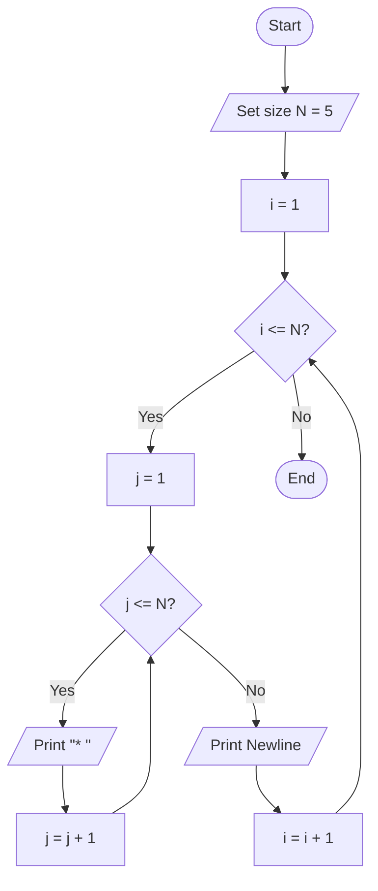

# Lab 19 – Nested Loops

This folder contains the complete solutions for this lab, including C source programs, flowcharts, input specifications, and verified outputs.

---

### <a id='question-56'></a>Question 56: Write a C program to print a right-angled star pattern.

#### Flowchart


#### C Program (Code)
```c
#include <stdio.h>

int main(void) {
    int rows = 5;

    printf("Right-angled star pattern (5 rows):\n");
    for (int i = 1; i <= rows; i++) {
        for (int j = 1; j <= i; j++) {
            printf("* ");
        }
        printf("\n");
    }

    return 0;
}
```

#### Program Input
```text
No input required.
```

#### Program Output
```text
Right-angled star pattern (5 rows):
* 
* * 
* * * 
* * * * 
* * * * *
```

---

### <a id='question-57'></a>Question 57: Write a C program to print a square star pattern.

#### Flowchart


#### C Program (Code)
```c
#include <stdio.h>

int main(void) {
    int size = 5;

    printf("Square star pattern (5x5):\n");
    for (int i = 1; i <= size; i++) {
        for (int j = 1; j <= size; j++) {
            printf("* ");
        }
        printf("\n");
    }

    return 0;
}
```

#### Program Input
```text
No input required.
```

#### Program Output
```text
Square star pattern (5x5):
* * * * * 
* * * * * 
* * * * * 
* * * * * 
* * * * *
```

---
