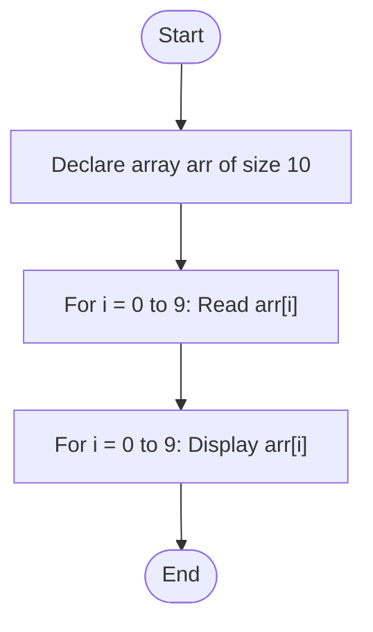
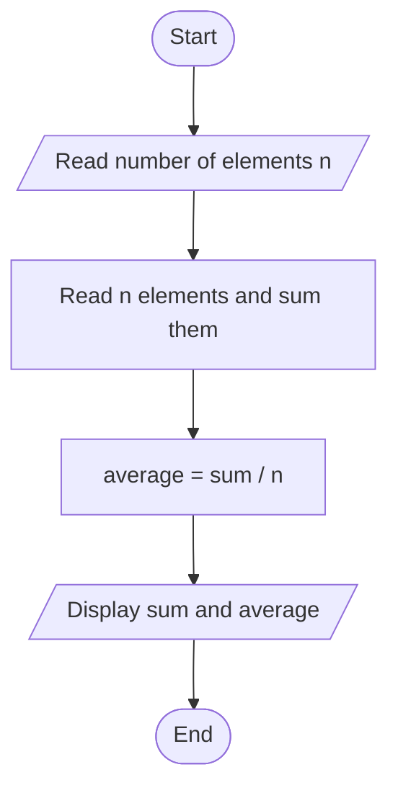

# Lab 20 – Arrays

This folder contains the complete solutions for this lab, including C source programs, flowcharts, input specifications, and verified outputs.

---

### <a id='question-59'></a>Question 59: Write a C program to input and display the elements of a one-dimensional array from 1 to 10 numbers.

#### Flowchart


#### C Program (Code)
```c
#include <stdio.h>

int main(void) {
    int arr[10];

    printf("Enter 10 integers for the array:\n");
    for (int i = 0; i < 10; i++) {
        printf("Element [%d]: ", i);
        if (scanf("%d", &arr[i]) != 1) return 1;
    }

    printf("\nArray elements are:\n");
    for (int i = 0; i < 10; i++) {
        printf("%d ", arr[i]);
    }
    printf("\n");

    return 0;
}
```

#### Program Input
```text
5 12 7 9 21 3 18 42 1 10
```

#### Program Output
```text
Enter 10 integers for the array:
Element [0]: Element [1]: Element [2]: Element [3]: Element [4]: Element [5]: Element [6]: Element [7]: Element [8]: Element [9]: 
Array elements are:
5 12 7 9 21 3 18 42 1 10
```

---

### <a id='question-60'></a>Question 60: Write a C program to find the sum and average of array elements from user input.

#### Flowchart


#### C Program (Code)
```c
#include <stdio.h>

int main(void) {
    int n;
    double sum = 0.0, average;

    printf("Enter number of elements in the array: ");
    if (scanf("%d", &n) != 1 || n <= 0) {
        printf("Invalid array size.\n");
        return 1;
    }

    double arr[n];
    printf("Enter %d numbers:\n", n);
    for (int i = 0; i < n; i++) {
        printf("Element [%d]: ", i);
        if (scanf("%lf", &arr[i]) != 1) return 1;
        sum += arr[i];
    }

    average = sum / n;

    printf("\n--- Results ---\n");
    printf("Sum     = %.2lf\n", sum);
    printf("Average = %.2lf\n", average);

    return 0;
}
```

#### Program Input
```text
5
10 20 30 40 50
```

#### Program Output
```text
Enter number of elements in the array: Enter 5 numbers:
Element [0]: Element [1]: Element [2]: Element [3]: Element [4]: 
--- Results ---
Sum     = 150.00
Average = 30.00
```

---
