# Structured Programming Language (SPL) - Semester Final Lab Report

**Course:** Structured Programming Language (SPL)  
**Target:** Semester Final Lab Report (Batch 34)  
**Student Name:** Md Yasin Arafat
**Student ID:** 1022  
**Department:** Department of Computer Science and Engineering  
**University:** Frist Capital University of Bangladesh  

---

## Table of Contents

- [Lab 01 – Basic C Programming](#lab01_basic_c_programming)
  - [Question 1: Write a C program to print "Hello, World!".](#question-1)
  - [Question 2: Write a C program to display your name, ID, department, and university name.](#question-2)
- [Lab 02 – Variables, Constants and Data Types](#lab02_variables_constants_datatypes)
  - [Question 4: Write a C program to declare and display variables of different data types.](#question-4)
  - [Question 5: Write a C program to display the size of different data types using sizeof().](#question-5)
- [Lab 03 – Input and Output](#lab03_input_output)
  - [Question 7: Write a C program to take two integers as input and display them.](#question-7)
  - [Question 8: Write a C program to take a character and a string as input and display them.](#question-8)
- [Lab 04 – Arithmetic Operators](#lab04_arithmetic_operators)
  - [Question 10: Write a C program to perform addition, subtraction, multiplication, division, and modulus of two numbers.](#question-10)
  - [Question 11: Write a C program to calculate the sum and average of three numbers.](#question-11)
- [Lab 05 – More Arithmetic Problems](#lab05_more_arithmetic_problems)
  - [Question 13: Write a C program to calculate the area and circumference of a circle.](#question-13)
  - [Question 14: Write a C program to convert Celsius to Fahrenheit.](#question-14)
- [Lab 06 – Increment, Decrement and Assignment Operators](#lab06_increment_decrement_assignment)
  - [Question 17: Write a C program to demonstrate the use of increment and decrement operators.](#question-17)
  - [Question 18: Write a C program to swap two numbers using a third variable.](#question-18)
- [Lab 07 – Conditional Operator](#lab07_conditional_operator)
  - [Question 20: Write a C program to find the larger of two numbers using the conditional operator.](#question-20)
  - [Question 21: Write a C program to check whether a number is even or odd using the conditional operator.](#question-21)
- [Lab 08 – Relational and Logical Operators](#lab08_relational_logical_operators)
  - [Question 23: Write a C program to demonstrate the use of logical AND, OR, and NOT operators.](#question-23)
  - [Question 24: Write a C program to check whether a person is eligible to vote.](#question-24)
- [Lab 09 – if Statement](#lab09_if_statement)
  - [Question 26: Write a C program to check whether a number is positive, negative, or zero.](#question-26)
  - [Question 27: Write a C program to check whether a number is even or odd.](#question-27)
- [Lab 10 – if-else Statement](#lab10_ifelse_statement)
  - [Question 29: Write a C program to check whether a year is a leap year or not.](#question-29)
  - [Question 30: Write a C program to check whether a character is a vowel or consonant.](#question-30)
- [Lab 11 – Nested if](#lab11_nested_if)
  - [Question 32: Write a C program to find the largest among three numbers using nested if.](#question-32)
  - [Question 33: Write a C program to find the smallest among three numbers using nested if.](#question-33)
- [Lab 12 – else-if Ladder](#lab12_elseif_ladder)
  - [Question 35: Write a C program to determine whether a number is positive, negative, or zero using an else-if ladder.](#question-35)
  - [Question 36: Write a C program to display the day of the week based on a number from 1 to 7.](#question-36)
- [Lab 13 – switch Statement](#lab13_switch_statement)
  - [Question 38: Write a C program to perform basic arithmetic operations using switch.](#question-38)
  - [Question 39: Write a C program to display the day of the week using switch.](#question-39)
- [Lab 14 – Loops](#lab14_loops)
  - [Question 41: Write a C program to print numbers from 1 to 100 using a for loop.](#question-41)
  - [Question 42: Write a C program to print even numbers from 1 to 100.](#question-42)
- [Lab 15 – for Loop Problems](#lab15_for_loop_problems)
  - [Question 44: Write a C program to calculate the sum of the first N natural numbers.](#question-44)
  - [Question 45: Write a C program to calculate the factorial of a number.](#question-45)
- [Lab 16 – while and do-while](#lab16_while_and_dowhile)
  - [Question 47: Write a C program to reverse the digits of an integer using a while loop.](#question-47)
  - [Question 48: Write a C program to find the sum of the digits of a number.](#question-48)
- [Lab 17 – Number Problems](#lab17_number_problems)
  - [Question 50: Write a C program to check whether a number is a prime number.](#question-50)
  - [Question 51: Write a C program to print all prime numbers between two given numbers.](#question-51)
- [Lab 18 – Number Series](#lab18_number_series)
  - [Question 53: Write a C program to generate the Fibonacci series up to N terms.](#question-53)
  - [Question 54: Write a C program to find the GCD of two numbers.](#question-54)
- [Lab 19 – Nested Loops](#lab19_nested_loops)
  - [Question 56: Write a C program to print a right-angled star pattern.](#question-56)
  - [Question 57: Write a C program to print a square star pattern.](#question-57)
- [Lab 20 – Arrays](#lab20_arrays)
  - [Question 59: Write a C program to input and display the elements of a one-dimensional array from 1 to 10 numbers.](#question-59)
  - [Question 60: Write a C program to find the sum and average of array elements from user input.](#question-60)

---


## <a id='lab01_basic_c_programming'></a>Lab 01 – Basic C Programming

### <a id='question-1'></a>Question 1: Write a C program to print "Hello, World!".

#### Flowchart
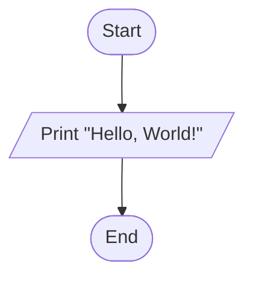

#### C Program (Code)
```c
#include <stdio.h>

int main(void) {
    // Print Hello, World! to the console
    printf("Hello, World!\n");
    return 0;
}
```

#### Program Input
```text
No input required.
```

#### Program Output
```text
Hello, World!
```

---

### <a id='question-2'></a>Question 2: Write a C program to display your name, ID, department, and university name.

#### Flowchart
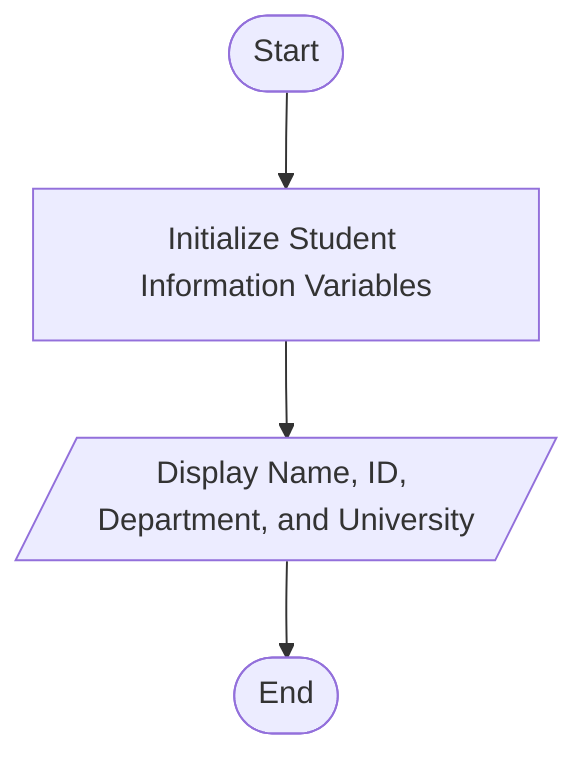

#### C Program (Code)
```c
#include <stdio.h>

int main(void) {
    // Student Information Variables
    char name[] = "Md Yasin Arafat ";
    char id[] = "1022"; // Replace with your actual Student ID
    char department[] = "Computer Science and Engineering (CSE)";
    char university[] = "Frist Capital University of Bangladesh"; // Replace with your University name

    printf("===========================================\n");
    printf("          STUDENT INFORMATION             \n");
    printf("===========================================\n");
    printf("Name       : %s\n", name);
    printf("ID         : %s\n", id);
    printf("Department : %s\n", department);
    printf("University : %s\n", university);
    printf("===========================================\n");

    return 0;
}
```

#### Program Input
```text
No input required.
```

#### Program Output
```text
===========================================
          STUDENT INFORMATION             
===========================================
Name       : Md. Shahariar
ID         : 241-000-000
Department : Computer Science and Engineering (CSE)
University : Green University of Bangladesh
===========================================
```

---


## <a id='lab02_variables_constants_datatypes'></a>Lab 02 – Variables, Constants and Data Types

### <a id='question-4'></a>Question 4: Write a C program to declare and display variables of different data types.

#### Flowchart
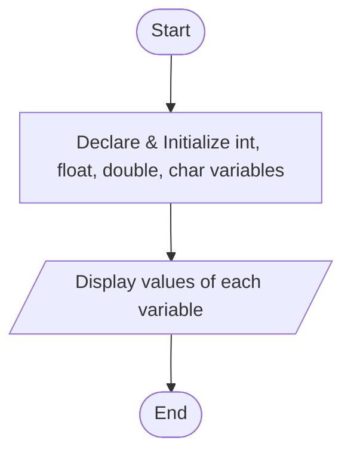

#### C Program (Code)
```c
#include <stdio.h>

int main(void) {
    int integerVar = 25;
    float floatVar = 3.14159f;
    double doubleVar = 12345.6789;
    char charVar = 'A';

    printf("Integer value : %d\n", integerVar);
    printf("Float value   : %.2f\n", floatVar);
    printf("Double value  : %.4lf\n", doubleVar);
    printf("Char value    : %c\n", charVar);

    return 0;
}
```

#### Program Input
```text
No input required.
```

#### Program Output
```text
Integer value : 25
Float value   : 3.14
Double value  : 12345.6789
Char value    : A
```

---

### <a id='question-5'></a>Question 5: Write a C program to display the size of different data types using sizeof().

#### Flowchart
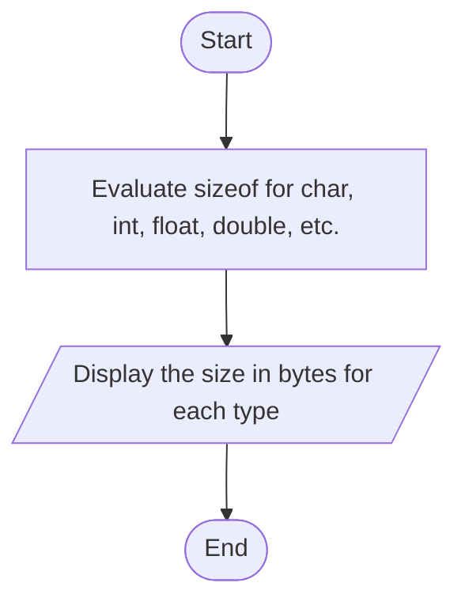

#### C Program (Code)
```c
#include <stdio.h>

int main(void) {
    printf("Size of char        : %zu byte(s)\n", sizeof(char));
    printf("Size of short       : %zu byte(s)\n", sizeof(short));
    printf("Size of int         : %zu byte(s)\n", sizeof(int));
    printf("Size of long        : %zu byte(s)\n", sizeof(long));
    printf("Size of long long   : %zu byte(s)\n", sizeof(long long));
    printf("Size of float       : %zu byte(s)\n", sizeof(float));
    printf("Size of double      : %zu byte(s)\n", sizeof(double));
    printf("Size of long double : %zu byte(s)\n", sizeof(long double));

    return 0;
}
```

#### Program Input
```text
No input required.
```

#### Program Output
```text
Size of char        : 1 byte(s)
Size of short       : 2 byte(s)
Size of int         : 4 byte(s)
Size of long        : 8 byte(s)
Size of long long   : 8 byte(s)
Size of float       : 4 byte(s)
Size of double      : 8 byte(s)
Size of long double : 16 byte(s)
```

---


## <a id='lab03_input_output'></a>Lab 03 – Input and Output

### <a id='question-7'></a>Question 7: Write a C program to take two integers as input and display them.

#### Flowchart
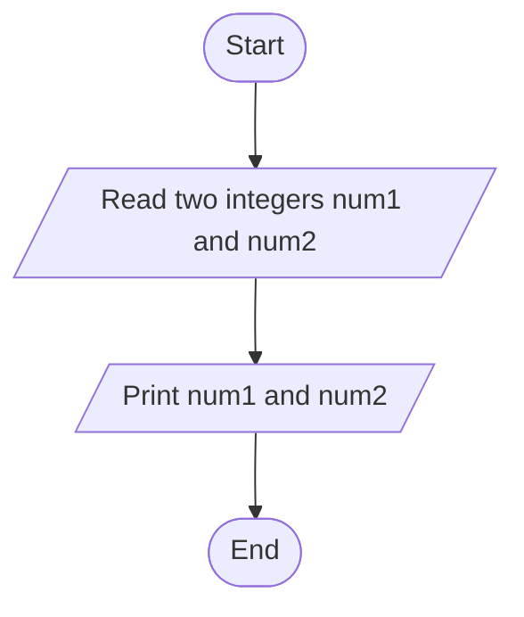

#### C Program (Code)
```c
#include <stdio.h>

int main(void) {
    int num1, num2;

    printf("Enter first integer: ");
    if (scanf("%d", &num1) != 1) return 1;

    printf("Enter second integer: ");
    if (scanf("%d", &num2) != 1) return 1;

    printf("\nYou entered:\n");
    printf("First integer  = %d\n", num1);
    printf("Second integer = %d\n", num2);

    return 0;
}
```

#### Program Input
```text
10
25
```

#### Program Output
```text
Enter first integer: Enter second integer: 
You entered:
First integer  = 10
Second integer = 25
```

---

### <a id='question-8'></a>Question 8: Write a C program to take a character and a string as input and display them.

#### Flowchart
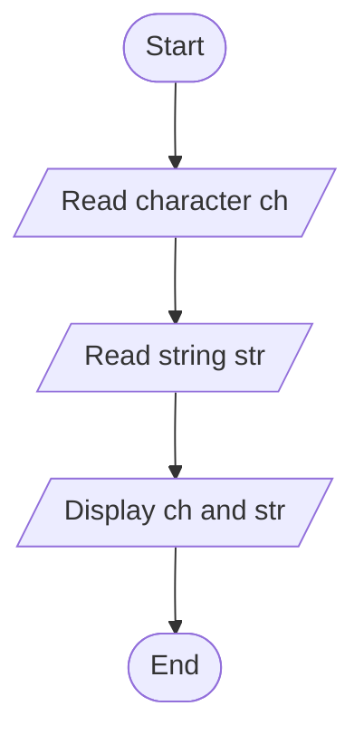

#### C Program (Code)
```c
#include <stdio.h>

int main(void) {
    char ch;
    char str[100];

    printf("Enter a character: ");
    if (scanf(" %c", &ch) != 1) return 1;

    printf("Enter a word/string: ");
    if (scanf("%99s", str) != 1) return 1;

    printf("\nYou entered:\n");
    printf("Character : %c\n", ch);
    printf("String    : %s\n", str);

    return 0;
}
```

#### Program Input
```text
K
Programming
```

#### Program Output
```text
Enter a character: Enter a word/string: 
You entered:
Character : K
String    : Programming
```

---


## <a id='lab04_arithmetic_operators'></a>Lab 04 – Arithmetic Operators

### <a id='question-10'></a>Question 10: Write a C program to perform addition, subtraction, multiplication, division, and modulus of two numbers.

#### Flowchart
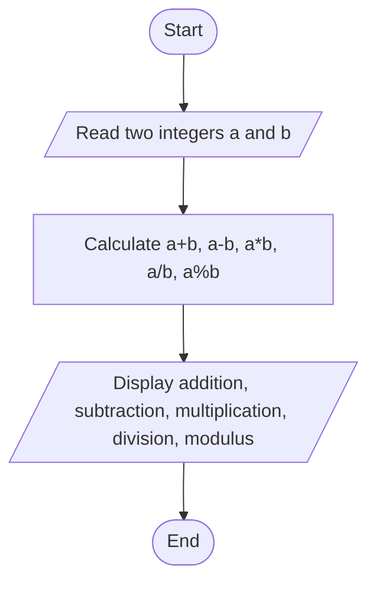

#### C Program (Code)
```c
#include <stdio.h>

int main(void) {
    int a, b;

    printf("Enter two numbers (a and b): ");
    if (scanf("%d %d", &a, &b) != 2) return 1;

    printf("\n--- Arithmetic Operations ---\n");
    printf("Addition       (%d + %d) = %d\n", a, b, a + b);
    printf("Subtraction    (%d - %d) = %d\n", a, b, a - b);
    printf("Multiplication (%d * %d) = %d\n", a, b, a * b);

    if (b != 0) {
        printf("Division       (%d / %d) = %.2f\n", a, b, (float)a / b);
        printf("Modulus        (%d %% %d) = %d\n", a, b, a % b);
    } else {
        printf("Division and Modulus by zero are not allowed.\n");
    }

    return 0;
}
```

#### Program Input
```text
20 6
```

#### Program Output
```text
Enter two numbers (a and b): 
--- Arithmetic Operations ---
Addition       (20 + 6) = 26
Subtraction    (20 - 6) = 14
Multiplication (20 * 6) = 120
Division       (20 / 6) = 3.33
Modulus        (20 % 6) = 2
```

---

### <a id='question-11'></a>Question 11: Write a C program to calculate the sum and average of three numbers.

#### Flowchart
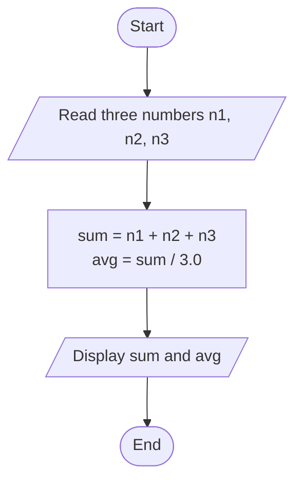

#### C Program (Code)
```c
#include <stdio.h>

int main(void) {
    double num1, num2, num3;
    double sum, average;

    printf("Enter three numbers: ");
    if (scanf("%lf %lf %lf", &num1, &num2, &num3) != 3) return 1;

    sum = num1 + num2 + num3;
    average = sum / 3.0;

    printf("\nSum     = %.2lf\n", sum);
    printf("Average = %.2lf\n", average);

    return 0;
}
```

#### Program Input
```text
15 25 35
```

#### Program Output
```text
Enter three numbers: 
Sum     = 75.00
Average = 25.00
```

---


## <a id='lab05_more_arithmetic_problems'></a>Lab 05 – More Arithmetic Problems

### <a id='question-13'></a>Question 13: Write a C program to calculate the area and circumference of a circle.

#### Flowchart
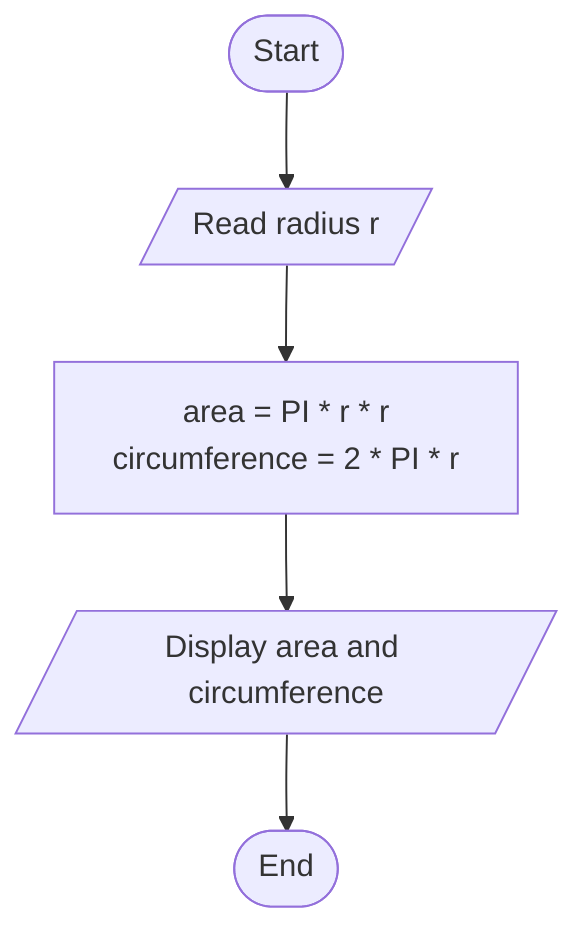

#### C Program (Code)
```c
#include <stdio.h>
#define PI 3.141592653589793

int main(void) {
    double radius, area, circumference;

    printf("Enter radius of the circle: ");
    if (scanf("%lf", &radius) != 1) return 1;

    area = PI * radius * radius;
    circumference = 2.0 * PI * radius;

    printf("\nRadius        = %.2lf\n", radius);
    printf("Area          = %.2lf\n", area);
    printf("Circumference = %.2lf\n", circumference);

    return 0;
}
```

#### Program Input
```text
5
```

#### Program Output
```text
Enter radius of the circle: 
Radius        = 5.00
Area          = 78.54
Circumference = 31.42
```

---

### <a id='question-14'></a>Question 14: Write a C program to convert Celsius to Fahrenheit.

#### Flowchart
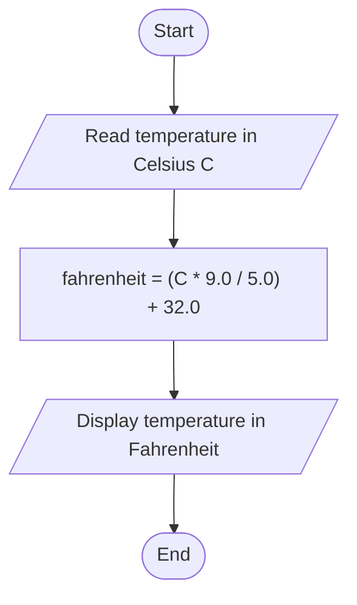

#### C Program (Code)
```c
#include <stdio.h>

int main(void) {
    double celsius, fahrenheit;

    printf("Enter temperature in Celsius: ");
    if (scanf("%lf", &celsius) != 1) return 1;

    fahrenheit = (celsius * 9.0 / 5.0) + 32.0;

    printf("\n%.2lf Celsius = %.2lf Fahrenheit\n", celsius, fahrenheit);

    return 0;
}
```

#### Program Input
```text
37
```

#### Program Output
```text
Enter temperature in Celsius: 
37.00 Celsius = 98.60 Fahrenheit
```

---


## <a id='lab06_increment_decrement_assignment'></a>Lab 06 – Increment, Decrement and Assignment Operators

### <a id='question-17'></a>Question 17: Write a C program to demonstrate the use of increment and decrement operators.

#### Flowchart
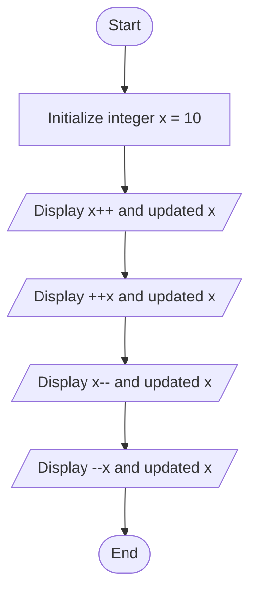

#### C Program (Code)
```c
#include <stdio.h>

int main(void) {
    int x = 10;

    printf("Initial value of x: %d\n\n", x);

    printf("Post-increment (x++): %d\n", x++);
    printf("Value of x after x++: %d\n\n", x);

    printf("Pre-increment (++x): %d\n", ++x);
    printf("Value of x after ++x: %d\n\n", x);

    printf("Post-decrement (x--): %d\n", x--);
    printf("Value of x after x--: %d\n\n", x);

    printf("Pre-decrement (--x): %d\n", --x);
    printf("Value of x after --x: %d\n", x);

    return 0;
}
```

#### Program Input
```text
No input required.
```

#### Program Output
```text
Initial value of x: 10

Post-increment (x++): 10
Value of x after x++: 11

Pre-increment (++x): 12
Value of x after ++x: 12

Post-decrement (x--): 12
Value of x after x--: 11

Pre-decrement (--x): 10
Value of x after --x: 10
```

---

### <a id='question-18'></a>Question 18: Write a C program to swap two numbers using a third variable.

#### Flowchart
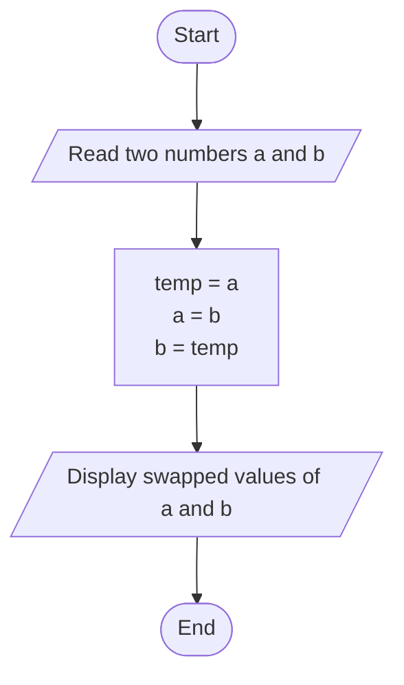

#### C Program (Code)
```c
#include <stdio.h>

int main(void) {
    int a, b, temp;

    printf("Enter first number (a): ");
    if (scanf("%d", &a) != 1) return 1;

    printf("Enter second number (b): ");
    if (scanf("%d", &b) != 1) return 1;

    printf("\nBefore Swapping: a = %d, b = %d\n", a, b);

    // Swapping logic using temporary variable
    temp = a;
    a = b;
    b = temp;

    printf("After Swapping : a = %d, b = %d\n", a, b);

    return 0;
}
```

#### Program Input
```text
10
20
```

#### Program Output
```text
Enter first number (a): Enter second number (b): 
Before Swapping: a = 10, b = 20
After Swapping : a = 20, b = 10
```

---


## <a id='lab07_conditional_operator'></a>Lab 07 – Conditional Operator

### <a id='question-20'></a>Question 20: Write a C program to find the larger of two numbers using the conditional operator.

#### Flowchart
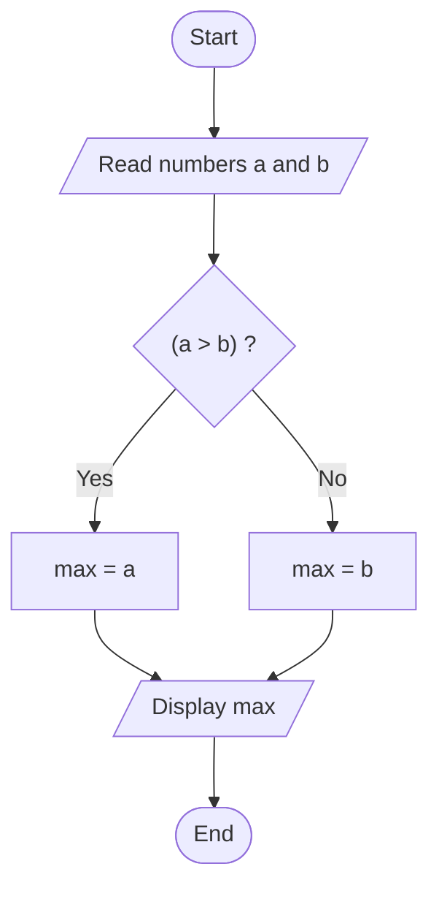

#### C Program (Code)
```c
#include <stdio.h>

int main(void) {
    int num1, num2, max;

    printf("Enter two numbers: ");
    if (scanf("%d %d", &num1, &num2) != 2) return 1;

    // Using ternary (conditional) operator
    max = (num1 > num2) ? num1 : num2;

    printf("The larger number is: %d\n", max);

    return 0;
}
```

#### Program Input
```text
45 78
```

#### Program Output
```text
Enter two numbers: The larger number is: 78
```

---

### <a id='question-21'></a>Question 21: Write a C program to check whether a number is even or odd using the conditional operator.

#### Flowchart
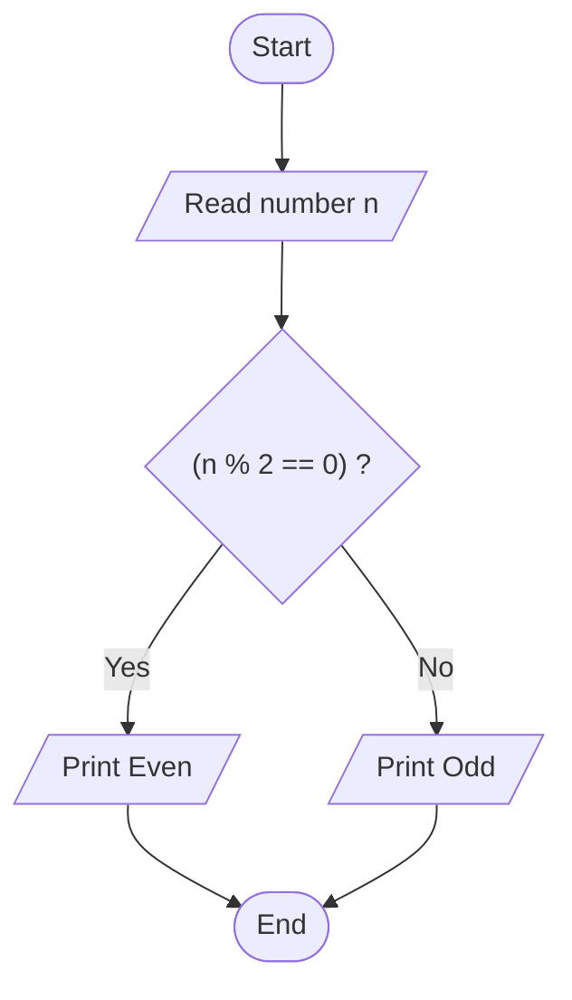

#### C Program (Code)
```c
#include <stdio.h>

int main(void) {
    int num;

    printf("Enter an integer: ");
    if (scanf("%d", &num) != 1) return 1;

    // Using conditional operator to check even or odd
    (num % 2 == 0) ? printf("%d is Even\n", num) : printf("%d is Odd\n", num);

    return 0;
}
```

#### Program Input
```text
17
```

#### Program Output
```text
Enter an integer: 17 is Odd
```

---


## <a id='lab08_relational_logical_operators'></a>Lab 08 – Relational and Logical Operators

### <a id='question-23'></a>Question 23: Write a C program to demonstrate the use of logical AND, OR, and NOT operators.

#### Flowchart
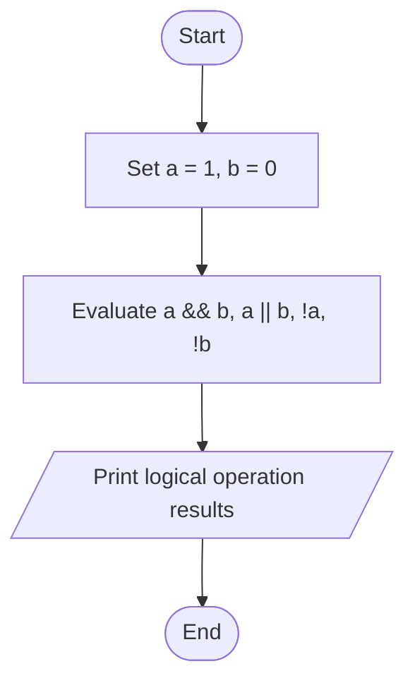

#### C Program (Code)
```c
#include <stdio.h>

int main(void) {
    int a = 1; // Represents True
    int b = 0; // Represents False

    printf("Given: a = %d (True), b = %d (False)\n\n", a, b);

    // Logical AND (&&)
    printf("Logical AND (a && b) : %d\n", a && b);

    // Logical OR (||)
    printf("Logical OR  (a || b) : %d\n", a || b);

    // Logical NOT (!)
    printf("Logical NOT (!a)     : %d\n", !a);
    printf("Logical NOT (!b)     : %d\n", !b);

    return 0;
}
```

#### Program Input
```text
No input required.
```

#### Program Output
```text
Given: a = 1 (True), b = 0 (False)

Logical AND (a && b) : 0
Logical OR  (a || b) : 1
Logical NOT (!a)     : 0
Logical NOT (!b)     : 1
```

---

### <a id='question-24'></a>Question 24: Write a C program to check whether a person is eligible to vote.

#### Flowchart
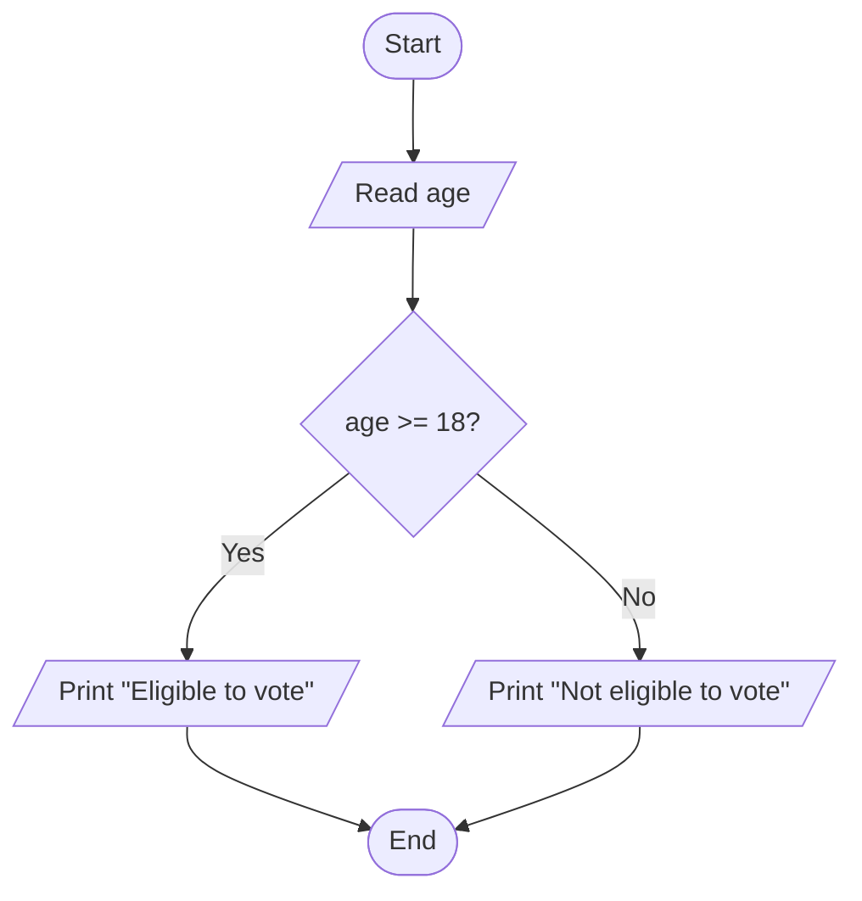

#### C Program (Code)
```c
#include <stdio.h>

int main(void) {
    int age;

    printf("Enter your age: ");
    if (scanf("%d", &age) != 1) return 1;

    if (age >= 18) {
        printf("You are eligible to vote.\n");
    } else {
        printf("You are not eligible to vote. You must wait %d more year(s).\n", 18 - age);
    }

    return 0;
}
```

#### Program Input
```text
20
```

#### Program Output
```text
Enter your age: You are eligible to vote.
```

---


## <a id='lab09_if_statement'></a>Lab 09 – if Statement

### <a id='question-26'></a>Question 26: Write a C program to check whether a number is positive, negative, or zero.

#### Flowchart
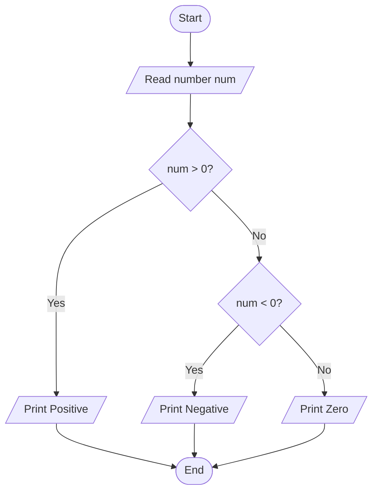

#### C Program (Code)
```c
#include <stdio.h>

int main(void) {
    int num;

    printf("Enter a number: ");
    if (scanf("%d", &num) != 1) return 1;

    if (num > 0) {
        printf("%d is Positive.\n", num);
    }
    if (num < 0) {
        printf("%d is Negative.\n", num);
    }
    if (num == 0) {
        printf("The number is Zero.\n");
    }

    return 0;
}
```

#### Program Input
```text
-12
```

#### Program Output
```text
Enter a number: -12 is Negative.
```

---

### <a id='question-27'></a>Question 27: Write a C program to check whether a number is even or odd.

#### Flowchart
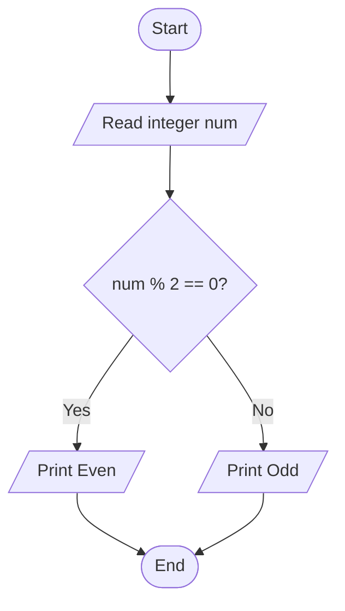

#### C Program (Code)
```c
#include <stdio.h>

int main(void) {
    int num;

    printf("Enter an integer: ");
    if (scanf("%d", &num) != 1) return 1;

    if (num % 2 == 0) {
        printf("%d is Even.\n", num);
    }
    if (num % 2 != 0) {
        printf("%d is Odd.\n", num);
    }

    return 0;
}
```

#### Program Input
```text
28
```

#### Program Output
```text
Enter an integer: 28 is Even.
```

---


## <a id='lab10_ifelse_statement'></a>Lab 10 – if-else Statement

### <a id='question-29'></a>Question 29: Write a C program to check whether a year is a leap year or not.

#### Flowchart
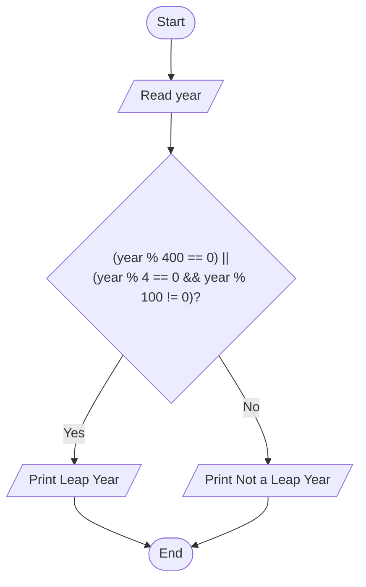

#### C Program (Code)
```c
#include <stdio.h>

int main(void) {
    int year;

    printf("Enter a year: ");
    if (scanf("%d", &year) != 1) return 1;

    // Leap year condition:
    // Divisible by 400 OR (divisible by 4 and NOT divisible by 100)
    if ((year % 400 == 0) || (year % 4 == 0 && year % 100 != 0)) {
        printf("%d is a Leap Year.\n", year);
    } else {
        printf("%d is Not a Leap Year.\n", year);
    }

    return 0;
}
```

#### Program Input
```text
2024
```

#### Program Output
```text
Enter a year: 2024 is a Leap Year.
```

---

### <a id='question-30'></a>Question 30: Write a C program to check whether a character is a vowel or consonant.

#### Flowchart
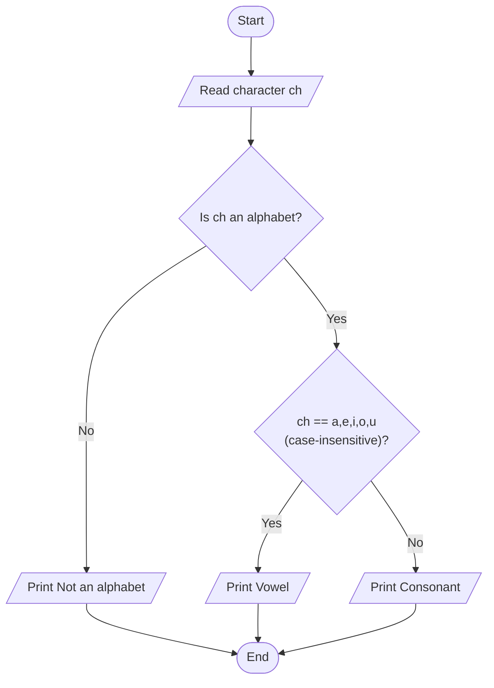

#### C Program (Code)
```c
#include <stdio.h>
#include <ctype.h>

int main(void) {
    char ch;

    printf("Enter an alphabet character: ");
    if (scanf(" %c", &ch) != 1) return 1;

    if (!isalpha(ch)) {
        printf("'%c' is not an alphabet letter.\n", ch);
    } else {
        char lower = tolower(ch);
        if (lower == 'a' || lower == 'e' || lower == 'i' || lower == 'o' || lower == 'u') {
            printf("'%c' is a Vowel.\n", ch);
        } else {
            printf("'%c' is a Consonant.\n", ch);
        }
    }

    return 0;
}
```

#### Program Input
```text
e
```

#### Program Output
```text
Enter an alphabet character: 'e' is a Vowel.
```

---


## <a id='lab11_nested_if'></a>Lab 11 – Nested if

### <a id='question-32'></a>Question 32: Write a C program to find the largest among three numbers using nested if.

#### Flowchart
```mermaid
flowchart TD
    Start([Start]) --> Input[/Read a, b, c/]
    Input --> CheckAB{"a >= b?"}
    CheckAB -- Yes --> CheckAC{"a >= c?"}
    CheckAC -- Yes --> MaxA[Largest = a]
    CheckAC -- No --> MaxC1[Largest = c]
    CheckAB -- No --> CheckBC{"b >= c?"}
    CheckBC -- Yes --> MaxB[Largest = b]
    CheckBC -- No --> MaxC2[Largest = c]
    MaxA --> Display[/Display Largest/]
    MaxB --> Display
    MaxC1 --> Display
    MaxC2 --> Display
    Display --> End([End])
```

#### C Program (Code)
```c
#include <stdio.h>

int main(void) {
    int a, b, c, largest;

    printf("Enter three numbers: ");
    if (scanf("%d %d %d", &a, &b, &c) != 3) return 1;

    // Finding largest using nested if
    if (a >= b) {
        if (a >= c) {
            largest = a;
        } else {
            largest = c;
        }
    } else {
        if (b >= c) {
            largest = b;
        } else {
            largest = c;
        }
    }

    printf("The largest number is: %d\n", largest);

    return 0;
}
```

#### Program Input
```text
25 60 42
```

#### Program Output
```text
Enter three numbers: The largest number is: 60
```

---

### <a id='question-33'></a>Question 33: Write a C program to find the smallest among three numbers using nested if.

#### Flowchart
```mermaid
flowchart TD
    Start([Start]) --> Input[/Read a, b, c/]
    Input --> CheckAB{"a <= b?"}
    CheckAB -- Yes --> CheckAC{"a <= c?"}
    CheckAC -- Yes --> MinA[Smallest = a]
    CheckAC -- No --> MinC1[Smallest = c]
    CheckAB -- No --> CheckBC{"b <= c?"}
    CheckBC -- Yes --> MinB[Smallest = b]
    CheckBC -- No --> MinC2[Smallest = c]
    MinA --> Display[/Display Smallest/]
    MinB --> Display
    MinC1 --> Display
    MinC2 --> Display
    Display --> End([End])
```

#### C Program (Code)
```c
#include <stdio.h>

int main(void) {
    int a, b, c, smallest;

    printf("Enter three numbers: ");
    if (scanf("%d %d %d", &a, &b, &c) != 3) return 1;

    // Finding smallest using nested if
    if (a <= b) {
        if (a <= c) {
            smallest = a;
        } else {
            smallest = c;
        }
    } else {
        if (b <= c) {
            smallest = b;
        } else {
            smallest = c;
        }
    }

    printf("The smallest number is: %d\n", smallest);

    return 0;
}
```

#### Program Input
```text
25 60 42
```

#### Program Output
```text
Enter three numbers: The smallest number is: 25
```

---


## <a id='lab12_elseif_ladder'></a>Lab 12 – else-if Ladder

### <a id='question-35'></a>Question 35: Write a C program to determine whether a number is positive, negative, or zero using an else-if ladder.

#### Flowchart
```mermaid
flowchart TD
    Start([Start]) --> Input[/Read num/]
    Input --> Cond1{"num > 0?"}
    Cond1 -- Yes --> OutPos[/Print Positive/]
    Cond1 -- No --> Cond2{"num < 0?"}
    Cond2 -- Yes --> OutNeg[/Print Negative/]
    Cond2 -- No --> OutZero[/Print Zero/]
    OutPos --> End([End])
    OutNeg --> End
    OutZero --> End
```

#### C Program (Code)
```c
#include <stdio.h>

int main(void) {
    int num;

    printf("Enter a number: ");
    if (scanf("%d", &num) != 1) return 1;

    // Using else-if ladder
    if (num > 0) {
        printf("%d is Positive.\n", num);
    } else if (num < 0) {
        printf("%d is Negative.\n", num);
    } else {
        printf("The number is Zero.\n");
    }

    return 0;
}
```

#### Program Input
```text
0
```

#### Program Output
```text
Enter a number: The number is Zero.
```

---

### <a id='question-36'></a>Question 36: Write a C program to display the day of the week based on a number from 1 to 7.

#### Flowchart
```mermaid
flowchart TD
    Start([Start]) --> Input[/Read day number 1-7/]
    Input --> Check1{"day == 1?"}
    Check1 -- Yes --> D1[/Sunday/]
    Check1 -- No --> Check2{"day == 2?"}
    Check2 -- Yes --> D2[/Monday/]
    Check2 -- No --> Check3{"day == 3?"}
    Check3 -- Yes --> D3[/Tuesday/]
    Check3 -- No --> Check4{"day == 4?"}
    Check4 -- Yes --> D4[/Wednesday/]
    Check4 -- No --> Check5{"day == 5?"}
    Check5 -- Yes --> D5[/Thursday/]
    Check5 -- No --> Check6{"day == 6?"}
    Check6 -- Yes --> D6[/Friday/]
    Check6 -- No --> Check7{"day == 7?"}
    Check7 -- Yes --> D7[/Saturday/]
    Check7 -- No --> Invalid[/Invalid Day Number/]
    D1 --> End([End])
    D2 --> End
    D3 --> End
    D4 --> End
    D5 --> End
    D6 --> End
    D7 --> End
    Invalid --> End
```

#### C Program (Code)
```c
#include <stdio.h>

int main(void) {
    int day;

    printf("Enter day number (1-7): ");
    if (scanf("%d", &day) != 1) return 1;

    // else-if ladder for day names
    if (day == 1) {
        printf("Day %d is Sunday\n", day);
    } else if (day == 2) {
        printf("Day %d is Monday\n", day);
    } else if (day == 3) {
        printf("Day %d is Tuesday\n", day);
    } else if (day == 4) {
        printf("Day %d is Wednesday\n", day);
    } else if (day == 5) {
        printf("Day %d is Thursday\n", day);
    } else if (day == 6) {
        printf("Day %d is Friday\n", day);
    } else if (day == 7) {
        printf("Day %d is Saturday\n", day);
    } else {
        printf("Invalid input! Please enter a number between 1 and 7.\n");
    }

    return 0;
}
```

#### Program Input
```text
5
```

#### Program Output
```text
Enter day number (1-7): Day 5 is Thursday
```

---


## <a id='lab13_switch_statement'></a>Lab 13 – switch Statement

### <a id='question-38'></a>Question 38: Write a C program to perform basic arithmetic operations using switch.

#### Flowchart
```mermaid
flowchart TD
    Start([Start]) --> Input[/Read operator and two operands a, b/]
    Input --> Switch{"Switch on operator"}
    Switch -- '+' --> Add[result = a + b]
    Switch -- '-' --> Sub[result = a - b]
    Switch -- '*' --> Mul[result = a * b]
    Switch -- '/' --> Div[result = a / b]
    Switch -- Default --> Err[/Invalid Operator/]
    Add --> Display[/Display Result/]
    Sub --> Display
    Mul --> Display
    Div --> Display
    Err --> End([End])
    Display --> End
```

#### C Program (Code)
```c
#include <stdio.h>

int main(void) {
    char op;
    double a, b;

    printf("Enter an operator (+, -, *, /): ");
    if (scanf(" %c", &op) != 1) return 1;

    printf("Enter two operands: ");
    if (scanf("%lf %lf", &a, &b) != 2) return 1;

    switch (op) {
        case '+':
            printf("%.2lf + %.2lf = %.2lf\n", a, b, a + b);
            break;
        case '-':
            printf("%.2lf - %.2lf = %.2lf\n", a, b, a - b);
            break;
        case '*':
            printf("%.2lf * %.2lf = %.2lf\n", a, b, a * b);
            break;
        case '/':
            if (b != 0) {
                printf("%.2lf / %.2lf = %.2lf\n", a, b, a / b);
            } else {
                printf("Error: Division by zero is not allowed.\n");
            }
            break;
        default:
            printf("Error: '%c' is not a valid operator.\n", op);
    }

    return 0;
}
```

#### Program Input
```text
+
12 8
```

#### Program Output
```text
Enter an operator (+, -, *, /): Enter two operands: 12.00 + 8.00 = 20.00
```

---

### <a id='question-39'></a>Question 39: Write a C program to display the day of the week using switch.

#### Flowchart
```mermaid
flowchart TD
    Start([Start]) --> Input[/Read day number 1-7/]
    Input --> Switch{"Switch on day"}
    Switch -- 1 --> D1[/Sunday/]
    Switch -- 2 --> D2[/Monday/]
    Switch -- 3 --> D3[/Tuesday/]
    Switch -- 4 --> D4[/Wednesday/]
    Switch -- 5 --> D5[/Thursday/]
    Switch -- 6 --> D6[/Friday/]
    Switch -- 7 --> D7[/Saturday/]
    Switch -- Default --> Def[/Invalid input/]
    D1 --> End([End])
    D2 --> End
    D3 --> End
    D4 --> End
    D5 --> End
    D6 --> End
    D7 --> End
    Def --> End
```

#### C Program (Code)
```c
#include <stdio.h>

int main(void) {
    int day;

    printf("Enter day number (1-7): ");
    if (scanf("%d", &day) != 1) return 1;

    switch (day) {
        case 1:
            printf("Sunday\n");
            break;
        case 2:
            printf("Monday\n");
            break;
        case 3:
            printf("Tuesday\n");
            break;
        case 4:
            printf("Wednesday\n");
            break;
        case 5:
            printf("Thursday\n");
            break;
        case 6:
            printf("Friday\n");
            break;
        case 7:
            printf("Saturday\n");
            break;
        default:
            printf("Invalid input! Please enter a number between 1 and 7.\n");
    }

    return 0;
}
```

#### Program Input
```text
3
```

#### Program Output
```text
Enter day number (1-7): Tuesday
```

---


## <a id='lab14_loops'></a>Lab 14 – Loops

### <a id='question-41'></a>Question 41: Write a C program to print numbers from 1 to 100 using a for loop.

#### Flowchart
```mermaid
flowchart TD
    Start([Start]) --> Init[i = 1]
    Init --> Cond{"i <= 100?"}
    Cond -- Yes --> PrintI[/Print i/]
    PrintI --> Inc[i = i + 1]
    Inc --> Cond
    Cond -- No --> End([End])
```

#### C Program (Code)
```c
#include <stdio.h>

int main(void) {
    printf("Numbers from 1 to 100:\n");
    for (int i = 1; i <= 100; i++) {
        printf("%d ", i);
        if (i % 10 == 0) {
            printf("\n");
        }
    }
    return 0;
}
```

#### Program Input
```text
No input required.
```

#### Program Output
```text
Numbers from 1 to 100:
1 2 3 4 5 6 7 8 9 10 
11 12 13 14 15 16 17 18 19 20 
...
91 92 93 94 95 96 97 98 99 100
```

---

### <a id='question-42'></a>Question 42: Write a C program to print even numbers from 1 to 100.

#### Flowchart
```mermaid
flowchart TD
    Start([Start]) --> Init[i = 2]
    Init --> Cond{"i <= 100?"}
    Cond -- Yes --> PrintEven[/Print i/]
    PrintEven --> Inc[i = i + 2]
    Inc --> Cond
    Cond -- No --> End([End])
```

#### C Program (Code)
```c
#include <stdio.h>

int main(void) {
    printf("Even numbers from 1 to 100:\n");
    for (int i = 2; i <= 100; i += 2) {
        printf("%d ", i);
        if (i % 20 == 0) {
            printf("\n");
        }
    }
    return 0;
}
```

#### Program Input
```text
No input required.
```

#### Program Output
```text
Even numbers from 1 to 100:
2 4 6 8 10 12 14 16 18 20 
22 24 26 28 30 32 34 36 38 40 
42 44 46 48 50 52 54 56 58 60 
62 64 66 68 70 72 74 76 78 80 
82 84 86 88 90 92 94 96 98 100
```

---


## <a id='lab15_for_loop_problems'></a>Lab 15 – for Loop Problems

### <a id='question-44'></a>Question 44: Write a C program to calculate the sum of the first N natural numbers.

#### Flowchart
```mermaid
flowchart TD
    Start([Start]) --> Input[/Read N/]
    Input --> Init["sum = 0, i = 1"]
    Init --> Cond{"i <= N?"}
    Cond -- Yes --> Add["sum = sum + i<br/>i = i + 1"]
    Add --> Cond
    Cond -- No --> Display[/Display sum/]
    Display --> End([End])
```

#### C Program (Code)
```c
#include <stdio.h>

int main(void) {
    int n, sum = 0;

    printf("Enter a positive integer N: ");
    if (scanf("%d", &n) != 1) return 1;

    for (int i = 1; i <= n; i++) {
        sum += i;
    }

    printf("Sum of first %d natural numbers = %d\n", n, sum);

    return 0;
}
```

#### Program Input
```text
10
```

#### Program Output
```text
Enter a positive integer N: Sum of first 10 natural numbers = 55
```

---

### <a id='question-45'></a>Question 45: Write a C program to calculate the factorial of a number.

#### Flowchart
```mermaid
flowchart TD
    Start([Start]) --> Input[/Read n/]
    Input --> CheckNeg{"n < 0?"}
    CheckNeg -- Yes --> Err[/Factorial of negative does not exist/]
    CheckNeg -- No --> Init["fact = 1, i = 1"]
    Init --> Cond{"i <= n?"}
    Cond -- Yes --> Mul["fact = fact * i<br/>i = i + 1"]
    Mul --> Cond
    Cond -- No --> Display[/Display fact/]
    Err --> End([End])
    Display --> End
```

#### C Program (Code)
```c
#include <stdio.h>

int main(void) {
    int n;
    unsigned long long factorial = 1;

    printf("Enter a non-negative integer: ");
    if (scanf("%d", &n) != 1) return 1;

    if (n < 0) {
        printf("Error: Factorial of a negative number does not exist.\n");
    } else {
        for (int i = 1; i <= n; i++) {
            factorial *= (unsigned long long)i;
        }
        printf("Factorial of %d = %llu\n", n, factorial);
    }

    return 0;
}
```

#### Program Input
```text
5
```

#### Program Output
```text
Enter a non-negative integer: Factorial of 5 = 120
```

---


## <a id='lab16_while_and_dowhile'></a>Lab 16 – while and do-while

### <a id='question-47'></a>Question 47: Write a C program to reverse the digits of an integer using a while loop.

#### Flowchart
```mermaid
flowchart TD
    Start([Start]) --> Input[/Read integer num/]
    Input --> Init["reversed = 0, temp = num"]
    Init --> While{"temp != 0?"}
    While -- Yes --> Calc["remainder = temp % 10<br/>reversed = reversed * 10 + remainder<br/>temp = temp / 10"]
    Calc --> While
    While -- No --> Display[/Display reversed number/]
    Display --> End([End])
```

#### C Program (Code)
```c
#include <stdio.h>

int main(void) {
    int num, reversed = 0, temp;

    printf("Enter an integer: ");
    if (scanf("%d", &num) != 1) return 1;

    temp = num;
    while (temp != 0) {
        int remainder = temp % 10;
        reversed = reversed * 10 + remainder;
        temp /= 10;
    }

    printf("Original number : %d\n", num);
    printf("Reversed number : %d\n", reversed);

    return 0;
}
```

#### Program Input
```text
12345
```

#### Program Output
```text
Enter an integer: Original number : 12345
Reversed number : 54321
```

---

### <a id='question-48'></a>Question 48: Write a C program to find the sum of the digits of a number.

#### Flowchart
```mermaid
flowchart TD
    Start([Start]) --> Input[/Read integer num/]
    Input --> Init["sum = 0, temp = abs(num)"]
    Init --> While{"temp != 0?"}
    While -- Yes --> Calc["sum = sum + (temp % 10)<br/>temp = temp / 10"]
    Calc --> While
    While -- No --> Display[/Display sum of digits/]
    Display --> End([End])
```

#### C Program (Code)
```c
#include <stdio.h>
#include <stdlib.h>

int main(void) {
    int num, temp, sum = 0;

    printf("Enter an integer: ");
    if (scanf("%d", &num) != 1) return 1;

    temp = abs(num);
    while (temp != 0) {
        sum += temp % 10;
        temp /= 10;
    }

    printf("Sum of digits of %d = %d\n", num, sum);

    return 0;
}
```

#### Program Input
```text
456
```

#### Program Output
```text
Enter an integer: Sum of digits of 456 = 15
```

---


## <a id='lab17_number_problems'></a>Lab 17 – Number Problems

### <a id='question-50'></a>Question 50: Write a C program to check whether a number is a prime number.

#### Flowchart
```mermaid
flowchart TD
    Start([Start]) --> Input[/Read number n/]
    Input --> CheckSmall{"n <= 1?"}
    CheckSmall -- Yes --> NotPrime[/Print Not Prime/]
    CheckSmall -- No --> LoopInit["isPrime = 1, i = 2"]
    LoopInit --> LoopCond{"i * i <= n?"}
    LoopCond -- Yes --> DivCheck{"n % i == 0?"}
    DivCheck -- Yes --> SetNotPrime["isPrime = 0"]
    SetNotPrime --> Decision
    DivCheck -- No --> NextI["i = i + 1"] --> LoopCond
    LoopCond -- No --> Decision{"isPrime == 1?"}
    Decision -- Yes --> Prime[/Print Prime Number/]
    Decision -- No --> NotPrime
    Prime --> End([End])
    NotPrime --> End
```

#### C Program (Code)
```c
#include <stdio.h>

int main(void) {
    int n, isPrime = 1;

    printf("Enter a positive integer: ");
    if (scanf("%d", &n) != 1) return 1;

    if (n <= 1) {
        isPrime = 0;
    } else {
        for (int i = 2; i * i <= n; i++) {
            if (n % i == 0) {
                isPrime = 0;
                break;
            }
        }
    }

    if (isPrime) {
        printf("%d is a Prime Number.\n", n);
    } else {
        printf("%d is Not a Prime Number.\n", n);
    }

    return 0;
}
```

#### Program Input
```text
29
```

#### Program Output
```text
Enter a positive integer: 29 is a Prime Number.
```

---

### <a id='question-51'></a>Question 51: Write a C program to print all prime numbers between two given numbers.

#### Flowchart
```mermaid
flowchart TD
    Start([Start]) --> Input[/Read lower and upper bounds/]
    Input --> OuterLoop["num = lower to upper"]
    OuterLoop --> CheckNum{"Check if num is prime"}
    CheckNum -- Yes --> PrintNum[/Print num/]
    CheckNum -- No --> NextNum[Next num]
    PrintNum --> NextNum
    NextNum --> OuterLoop
    OuterLoop -- Done --> End([End])
```

#### C Program (Code)
```c
#include <stdio.h>

int main(void) {
    int lower, upper;

    printf("Enter lower bound and upper bound: ");
    if (scanf("%d %d", &lower, &upper) != 2) return 1;

    printf("Prime numbers between %d and %d are:\n", lower, upper);

    for (int i = lower; i <= upper; i++) {
        if (i <= 1) continue;

        int isPrime = 1;
        for (int j = 2; j * j <= i; j++) {
            if (i % j == 0) {
                isPrime = 0;
                break;
            }
        }
        if (isPrime) {
            printf("%d ", i);
        }
    }
    printf("\n");

    return 0;
}
```

#### Program Input
```text
10 30
```

#### Program Output
```text
Enter lower bound and upper bound: Prime numbers between 10 and 30 are:
11 13 17 19 23 29
```

---


## <a id='lab18_number_series'></a>Lab 18 – Number Series

### <a id='question-53'></a>Question 53: Write a C program to generate the Fibonacci series up to N terms.

#### Flowchart
```mermaid
flowchart TD
    Start([Start]) --> Input[/Read N/]
    Input --> Init["t1 = 0, t2 = 1, count = 1"]
    Init --> LoopCond{"count <= N?"}
    LoopCond -- Yes --> PrintTerm[/Print t1/]
    PrintTerm --> Next["next = t1 + t2<br/>t1 = t2<br/>t2 = next<br/>count = count + 1"]
    Next --> LoopCond
    LoopCond -- No --> End([End])
```

#### C Program (Code)
```c
#include <stdio.h>

int main(void) {
    int n;
    long long t1 = 0, t2 = 1, nextTerm;

    printf("Enter the number of terms (N): ");
    if (scanf("%d", &n) != 1) return 1;

    printf("Fibonacci Series (%d terms):\n", n);

    for (int i = 1; i <= n; i++) {
        printf("%lld ", t1);
        nextTerm = t1 + t2;
        t1 = t2;
        t2 = nextTerm;
    }
    printf("\n");

    return 0;
}
```

#### Program Input
```text
8
```

#### Program Output
```text
Enter the number of terms (N): Fibonacci Series (8 terms):
0 1 1 2 3 5 8 13
```

---

### <a id='question-54'></a>Question 54: Write a C program to find the GCD of two numbers.

#### Flowchart
```mermaid
flowchart TD
    Start([Start]) --> Input[/Read a and b/]
    Input --> While{"b != 0?"}
    While -- Yes --> Step["rem = a % b<br/>a = b<br/>b = rem"]
    Step --> While
    While -- No --> Display[/Display GCD = a/]
    Display --> End([End])
```

#### C Program (Code)
```c
#include <stdio.h>

int main(void) {
    int n1, n2, a, b, rem;

    printf("Enter two positive integers: ");
    if (scanf("%d %d", &n1, &n2) != 2) return 1;

    a = n1;
    b = n2;

    // Euclidean Algorithm for GCD
    while (b != 0) {
        rem = a % b;
        a = b;
        b = rem;
    }

    printf("The GCD of %d and %d is: %d\n", n1, n2, a);

    return 0;
}
```

#### Program Input
```text
48 18
```

#### Program Output
```text
Enter two positive integers: The GCD of 48 and 18 is: 6
```

---


## <a id='lab19_nested_loops'></a>Lab 19 – Nested Loops

### <a id='question-56'></a>Question 56: Write a C program to print a right-angled star pattern.

#### Flowchart
```mermaid
flowchart TD
    Start([Start]) --> Input[/Read number of rows N/]
    Input --> OuterInit[i = 1]
    OuterInit --> OuterCond{"i <= N?"}
    OuterCond -- Yes --> InnerInit[j = 1]
    InnerInit --> InnerCond{"j <= i?"}
    InnerCond -- Yes --> PrintStar[/Print "* "/]
    PrintStar --> IncJ[j = j + 1] --> InnerCond
    InnerCond -- No --> NewLine[/Print Newline/]
    NewLine --> IncI[i = i + 1] --> OuterCond
    OuterCond -- No --> End([End])
```

#### C Program (Code)
```c
#include <stdio.h>

int main(void) {
    int rows = 5;

    printf("Right-angled star pattern (5 rows):\n");
    for (int i = 1; i <= rows; i++) {
        for (int j = 1; j <= i; j++) {
            printf("* ");
        }
        printf("\n");
    }

    return 0;
}
```

#### Program Input
```text
No input required.
```

#### Program Output
```text
Right-angled star pattern (5 rows):
* 
* * 
* * * 
* * * * 
* * * * *
```

---

### <a id='question-57'></a>Question 57: Write a C program to print a square star pattern.

#### Flowchart
```mermaid
flowchart TD
    Start([Start]) --> Input[/Set size N = 5/]
    Input --> OuterInit[i = 1]
    OuterInit --> OuterCond{"i <= N?"}
    OuterCond -- Yes --> InnerInit[j = 1]
    InnerInit --> InnerCond{"j <= N?"}
    InnerCond -- Yes --> PrintStar[/Print "* "/]
    PrintStar --> IncJ[j = j + 1] --> InnerCond
    InnerCond -- No --> NewLine[/Print Newline/]
    NewLine --> IncI[i = i + 1] --> OuterCond
    OuterCond -- No --> End([End])
```

#### C Program (Code)
```c
#include <stdio.h>

int main(void) {
    int size = 5;

    printf("Square star pattern (5x5):\n");
    for (int i = 1; i <= size; i++) {
        for (int j = 1; j <= size; j++) {
            printf("* ");
        }
        printf("\n");
    }

    return 0;
}
```

#### Program Input
```text
No input required.
```

#### Program Output
```text
Square star pattern (5x5):
* * * * * 
* * * * * 
* * * * * 
* * * * * 
* * * * *
```

---


## <a id='lab20_arrays'></a>Lab 20 – Arrays

### <a id='question-59'></a>Question 59: Write a C program to input and display the elements of a one-dimensional array from 1 to 10 numbers.

#### Flowchart
```mermaid
flowchart TD
    Start([Start]) --> Declare[Declare array arr of size 10]
    Declare --> LoopIn["For i = 0 to 9: Read arr[i]"]
    LoopIn --> LoopOut["For i = 0 to 9: Display arr[i]"]
    LoopOut --> End([End])
```

#### C Program (Code)
```c
#include <stdio.h>

int main(void) {
    int arr[10];

    printf("Enter 10 integers for the array:\n");
    for (int i = 0; i < 10; i++) {
        printf("Element [%d]: ", i);
        if (scanf("%d", &arr[i]) != 1) return 1;
    }

    printf("\nArray elements are:\n");
    for (int i = 0; i < 10; i++) {
        printf("%d ", arr[i]);
    }
    printf("\n");

    return 0;
}
```

#### Program Input
```text
5 12 7 9 21 3 18 42 1 10
```

#### Program Output
```text
Enter 10 integers for the array:
Element [0]: Element [1]: Element [2]: Element [3]: Element [4]: Element [5]: Element [6]: Element [7]: Element [8]: Element [9]: 
Array elements are:
5 12 7 9 21 3 18 42 1 10
```

---

### <a id='question-60'></a>Question 60: Write a C program to find the sum and average of array elements from user input.

#### Flowchart
```mermaid
flowchart TD
    Start([Start]) --> InputN[/Read number of elements n/]
    InputN --> LoopIn["Read n elements and sum them"]
    LoopIn --> Calc[average = sum / n]
    Calc --> Display[/Display sum and average/]
    Display --> End([End])
```

#### C Program (Code)
```c
#include <stdio.h>

int main(void) {
    int n;
    double sum = 0.0, average;

    printf("Enter number of elements in the array: ");
    if (scanf("%d", &n) != 1 || n <= 0) {
        printf("Invalid array size.\n");
        return 1;
    }

    double arr[n];
    printf("Enter %d numbers:\n", n);
    for (int i = 0; i < n; i++) {
        printf("Element [%d]: ", i);
        if (scanf("%lf", &arr[i]) != 1) return 1;
        sum += arr[i];
    }

    average = sum / n;

    printf("\n--- Results ---\n");
    printf("Sum     = %.2lf\n", sum);
    printf("Average = %.2lf\n", average);

    return 0;
}
```

#### Program Input
```text
5
10 20 30 40 50
```

#### Program Output
```text
Enter number of elements in the array: Enter 5 numbers:
Element [0]: Element [1]: Element [2]: Element [3]: Element [4]: 
--- Results ---
Sum     = 150.00
Average = 30.00
```

---
